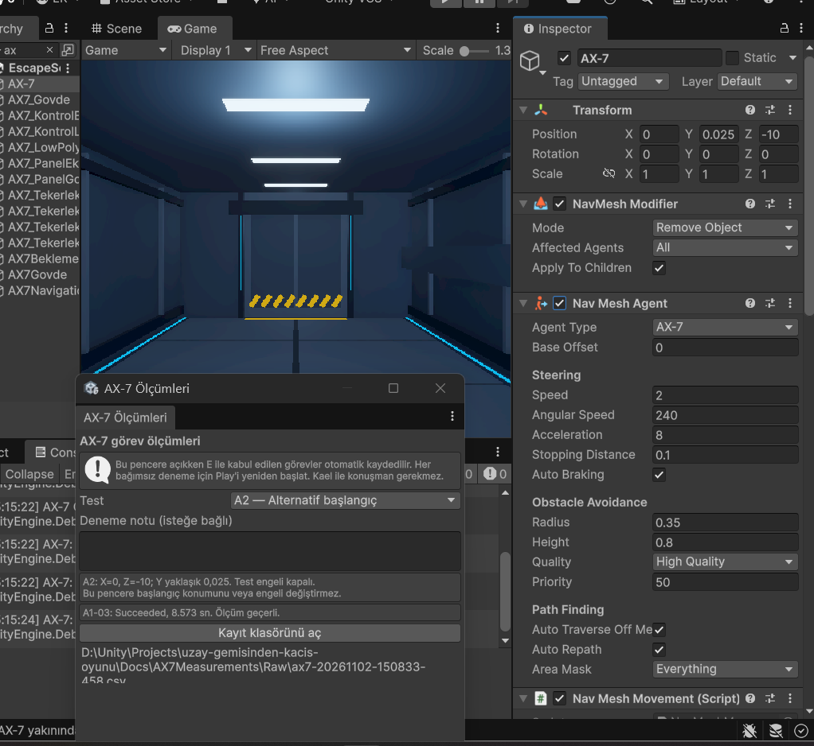
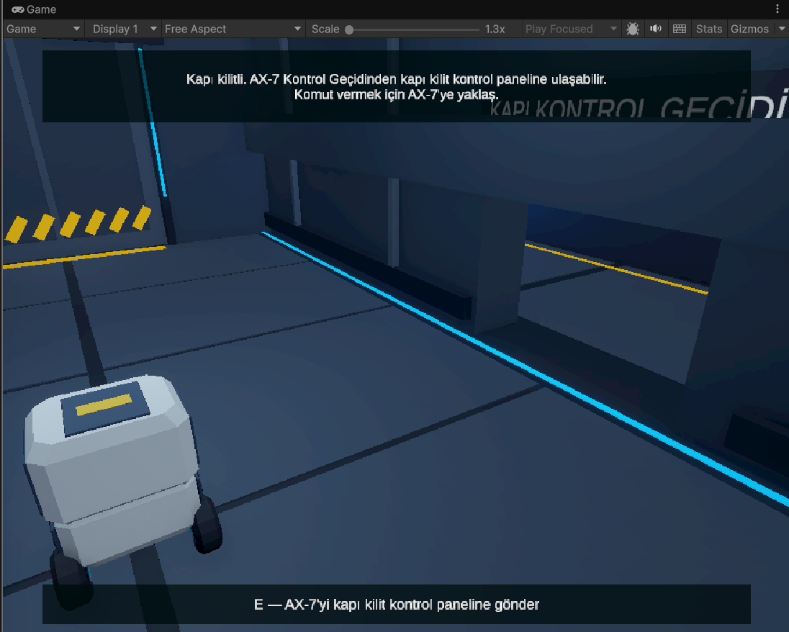
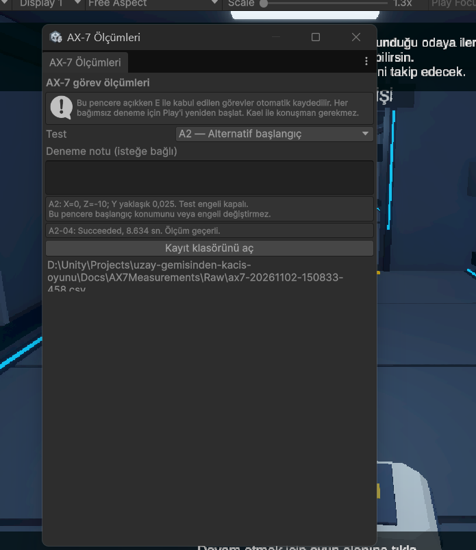
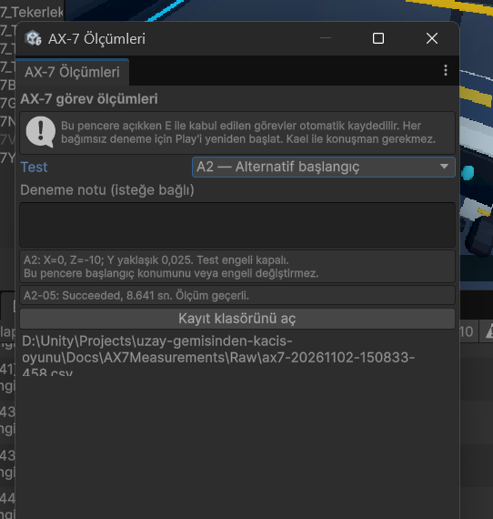
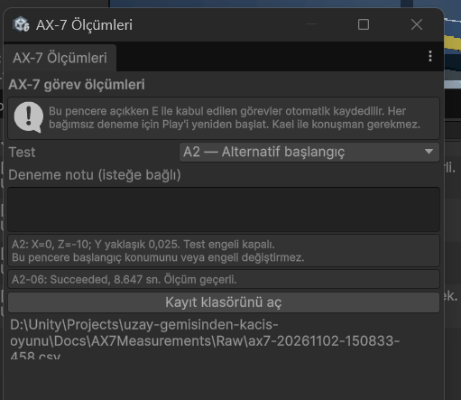

# AX-7 A2 — Alternatif başlangıç ölçümleri

Tarih: 2 Kasım 2026 (Europe/Istanbul). Ara sonuç kaydı; nihai README değildir.
Planlanan üç geçerli tekrarın tamamı bitti: üç görev de başarıyla tamamlandı.

Kaynak: `Raw/ax7-20261102-150833-458.csv` içindeki `A2-04`, `A2-05` ve `A2-06` kayıtları.
Araç oturumda bütün senaryolar için ortak sıra numarası kullandığından `04`,
A2'nin dördüncü tekrarı değil, oturumdaki dördüncü kabul edilen görevdir.

| Deneme | Gerçek başlangıç X/Y/Z | Sonuç | Oyun süresi (sn) | Gerçek zaman (sn) | Kapı açık | Ölçüm geçerli |
| --- | --- | --- | --- | --- | --- | --- |
| A2-04 | 0 / 0.025 / -10 | Succeeded | 8.634 | 8.632 | Evet | Evet |
| A2-05 | 0 / 0.025 / -10 | Succeeded | 8.641 | 8.638 | Evet | Evet |
| A2-06 | 0 / 0.025 / -10 | Succeeded | 8.647 | 8.645 | Evet | Evet |

Komut kabul edilmeden önce fiziksel kapı kapalı ve SensorTestEngeli devre dışıydı.
Engelde bekleme 0.000 saniyeydi. Kullanıcı alternatif konumu hazırladığını ve
oyun içi görevin tamamlandığını bildirdi; CSV kaydı aynı başlangıcı ve sonucu doğruladı.
- Planlanan / tamamlanan geçerli tekrar: 3 / 3.
- Görev başarı oranı: 3/3 = %100; yalnızca bu üç deneme için.
- Ortalama başarılı görev süresi, oyun saati: 8.641 saniye.
- Ortalama başarılı görev süresi, gerçek zaman: 8.638 saniye.
- Oyun süresi aralığı: 8.634–8.647 saniye.

Bu küçük örneklem genel güvenilirlik veya farklı koşullarda aynı başarı oranı
garantisi değildir. Engel koşulları ayrıca ölçülecektir.

## Kullanıcının sağladığı ekran görüntüleri

Görseller özgün dosyalarla aynı içerikle kopyalandı; kırpma veya görsel düzenleme yapılmadı.

İlk görselde kök AX-7 Position değerleri X=0, Y=0.025, Z=-10 ve NavMesh Agent'ın
etkin olduğu görülür. Ölçüm penceresinde A2 seçilidir. Alt satırdaki A1-03 sonucu,
önceki denemenin ekranda kalan sonucudur; bu ilk görsel A2'nin tamamlanma kanıtı değildir.

İkinci görsel komut öncesi sahne görünümünü, robotun yerini ve kapalı fiziksel kapıyı destekler.
Sayısal başlangıç konumu esas olarak Inspector görüntüsü ve komut anındaki CSV ile doğrulanır.

Yukarıdaki sonuç görselinde A2-04: Succeeded, 8.634 saniye ve ölçümün geçerli olduğu görülür.
A2 serisi tamamlandı. Bu dosya, ham kayıtlar ve sıradaki engel testleri ortak
nihai rapor hazırlanması için kullanılacaktır. Ana README değiştirilmedi.

