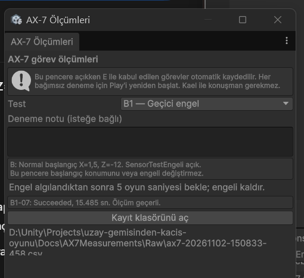
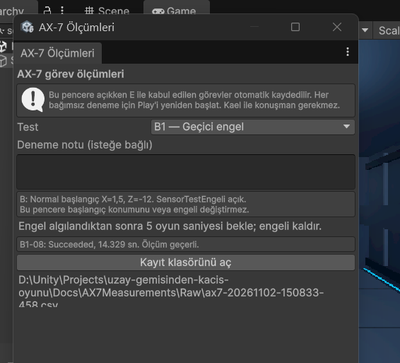
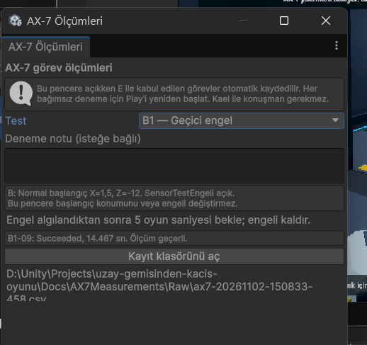
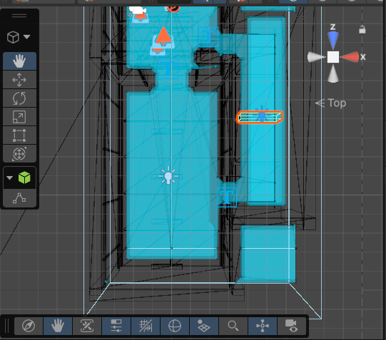

# AX-7 B1 — Geçici engel ölçümleri

Tarih: 2 Kasım 2026 (Europe/Istanbul). Ara sonuç kaydı; nihai README değildir.
Üç geçerli tekrar tamamlandı. Kaynak: `Raw/ax7-20261102-150833-458.csv`, `B1-07`, `B1-08`, `B1-09`.

| Deneme | Sonuç | Toplam oyun süresi (sn) | Gerçek zaman (sn) | Engel bekleme (sn) | Bekleme çıkarılmış görev süresi (sn) | Kapı açık | Araç geçerlilik kontrolü |
| --- | --- | --- | --- | --- | --- | --- | --- |
| B1-07 | Succeeded | 15.485 | 15.515 | 6.903 | 8.582 | Evet | Geçerli |
| B1-08 | Succeeded | 14.329 | 14.324 | 5.733 | 8.596 | Evet | Geçerli |
| B1-09 | Succeeded | 14.467 | 14.465 | 5.915 | 8.552 | Evet | Geçerli |

Üç denemede de başlangıç X=1.5, Y=0.025, Z=-12. Her birinde sensör beklemesi bir kez gözlendi;
engel kaldırılınca görev başarıyla tamamlandı ve fiziksel kapı açıldı.

## Operatörün bildirdiği bekleme farkı

Hazırlık talimatındaki hedef yaklaşık 5 saniyeydi. Kullanıcı engeli yaklaşık
6.9 saniye sonra kaldırdığını belirtti; araç gerçek beklemeyi 6.903 saniye ölçtü.
Bu fark korunmuştur; deney 5 saniyelik bekleme yapılmış gibi raporlanmayacaktır.
20 saniyelik engel zaman aşımı aşılmadığından devam etme davranışı beklenen
şekilde çalıştı. Araçtaki geçerli etiketi teknik kurulum kontrolünü ifade eder;
tam 5 saniyelik bekleme yapıldığını doğrulamaz.

Toplam süreleri karşılaştırırken farklı bekleme süreleri ayrıca gösterilmelidir.
15.485 - 6.903 = 8.582 saniye, bekleme çıkarılmış görev süresidir; yalnızca yürüme
süresi değildir, panel etkileşimini ve kapının açılmasını da içerir.
Üç ham kayıt değiştirilmeden korundu. Gerçek beklemeler 6.903, 5.733 ve 5.915 saniyedir; bunlar aynı bekleme süresine sahip deneyler gibi sunulmayacaktır.

## Üç tekrarın özeti

- Geçerli tekrar: 3/3. Görev başarısı ve senaryo beklentisi: 3/3 (%100, yalnızca bu örneklem).
- Ortalama toplam görev süresi (oyun saati): 14.760 saniye.
- Ortalama toplam görev süresi (gerçek zaman): 14.768 saniye.
- Ortalama gerçek engel bekleme süresi: 6.184 saniye.
- Bekleme çıkarılmış görev süresi ortalaması: 8.577 saniye.

Toplam süre ortalaması farklı operatör kaldırma gecikmelerini içerir; yalnızca
rota izleme hızı olarak yorumlanmamalıdır. Bekleme çıkarılmış süre de panel
ve kapı etkileşimlerini içerir. Küçük örneklem genel güvenilirlik garantisi değildir.
Kalıcı engel senaryosu henüz bu sonuçlara dahil değildir.

## Sonuç ekranları

Görseller özgün dosyalarla aynı içerikte saklandı; aşağıdakiler görev sonuç ekranlarıdır.

Ana README değiştirilmedi. Bu ayrı kayıt final raporu için saklanmaktadır.

## Sensör test engelinin sahnedeki yeri

Kullanıcının sağladığı kuş bakışı Scene görüntüsünde SensorTestEngeli turuncu
seçim çerçevesiyle, ana koridorun sağındaki dar kontrol geçidinde görülmektedir.
Sahnede kayıtlı merkez konumu X=4.5, Y=0.4, Z=-6; ölçeği X=2, Y=0.8, Z=0.3'tür.
Mavi alanlar NavMesh gösterimidir. Bu görsel deney düzeneğinin yerleşimini belgeler;
engel algılaması ve görev sonucu yukarıdaki CSV kayıtları ve sonuç ekranlarıyla desteklenir.
Görüntü kırpılmadan veya değiştirilmeden saklandı. Aynı düzenek B2 kalıcı engel
senaryosu belgelenirken de referans gösterilebilir.
