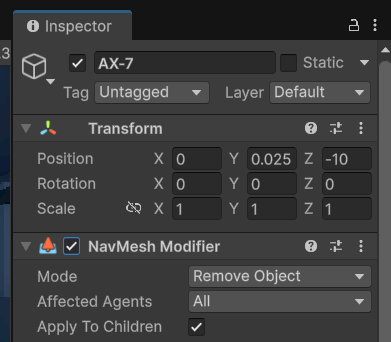
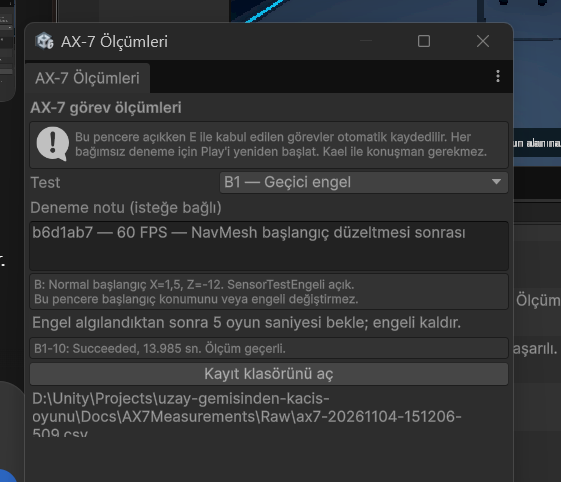
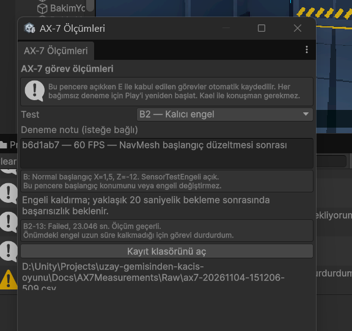

# AX-7 tekrarlı ölçümler — 4 Kasım 2026

Bu belge son README'ye daha sonra aktarılacak ayrı test kaydıdır. Gerçek EscapeScene içinde kullanıcı tarafından E komutuyla yapılan denemeler, AX7MeasurementWindow tarafından otomatik kaydedildi.

## Yöntem ve sürümler

- Unity 6000.3.26f1; aynı laptopta Unity Editor Play modu. Uygulamada hedef sınır 60 FPS'dir; sabit gerçek 60 FPS ölçüldüğü iddia edilmez.
- Her tekrar için Play yeniden başlatıldı; başlangıç durumu Waiting, kapı kapalı, timeScale=1. Ölçüm sırasında Unity duraklatılmadı.
- Süre E komutunun kabulünden görevin terminal durumuna kadardır; giriş hikâyesi süresi dahil değildir. Panel etkileşimi ve kapı açılışı dahil toplam görev süresidir; saf yürüme süresi değildir.
- A1/A2: `413c827`. B1/B2: `b6d1ab7` (NavMesh başlangıç sırası düzeltmesi sonrası). Gruplar farklı sürümlerde alındı; aynı sürümün birleşik performans deneyi olarak sunulmaz.
- A1/B1/B2 başlangıcı X=1.5, Y yaklaşık 0.025, Z=-12. A2 başlangıcı X=0, Y yaklaşık 0.025, Z=-10.
- A1/A2'de SensorTestEngeli kapalı; B1/B2'de başlangıçta açıktı. B1'de kullanıcı engeli algıladıktan yaklaşık 5 saniye sonra kaldırdı; B2'de kaldırılmadı.

Ham veriler: [13 kayıt](Raw/ax7-20261104-151206-509.csv). [Özet CSV](Summary-2026-11-04.csv). [Ana istatistiğe dahil etme kararı](TrialSelection-2026-11-04.csv).

## Ana sonuçlar

| Test | Denemeler | Toplam oyun süreleri (sn) | Ortalama (sn) | Beklenen davranış |
| --- | --- | --- | ---: | --- |
| A1 normal başlangıç | A1-01,02,03 | 8.578 / 8.555 / 8.581 | 8.571 | 3/3 panel görevi ve kapı açılışı başarılı |
| A2 alternatif başlangıç | A2-04,05,06 | 8.656 / 8.633 / 8.629 | 8.639 | 3/3 panel görevi ve kapı açılışı başarılı |
| B1 geçici engel | B1-08,09,10 | 14.168 / 14.035 / 13.985 | 14.063 | 3/3 bekleme sonrası devam ve başarı |
| B2 kalıcı engel | B2-11,12,13 | 23.043 / 23.057 / 23.046 | 23.049 | 3/3 engel zaman aşımı nedeniyle kontrollü Failed; kapı kapalı |

B2'de görev başarı oranı 0/3'tür; beklenen güvenli başarısızlık davranışını karşılama oranı 3/3'tür. Bunlar aynı ölçüt değildir. Engel algılama sonrası bekleme süreleri 20.007 / 20.009 / 20.006 saniyedir; toplam süreye engele kadar ilerleme de dahildir.

B1 ana tekrarlarında gerçek beklemeler 5.572 / 5.457 / 5.425 saniyedir. Elle kaldırma zamanlaması farklı olduğu için toplam süre farkları yalnızca yol bulma performansına atfedilmez.

## Korunan protokol sapması

B1-07: Succeeded, toplam 11.499 saniye, engelde bekleme 3.051 saniye. Kullanıcı engeli yaklaşık 3 saniyede yanlışlıkla kaldırdığını bildirdi. Ham CSV'deki `valid_for_stats=1` yalnız otomatik teknik kontrollerin sonucudur ve değiştirilmedi. Yaklaşık 5 saniye hedefinden sapma nedeniyle bu deneme ana B1 ortalamasına dahil edilmedi. Karar ayrı seçim CSV'sinde saklanır.

## Ekran görüntüleri

Kullanıcının gönderdiği sonuç görüntüleri [tarihli görsel klasöründe](Images/2026-11-04/) saklanır. Özellikle:

Bu sonuçlar Kael LLM kalitesi, tüm oyunun nihai Windows build'i veya gerçek FPS performansı için kanıt değildir. Otomatik AX-7 işlev kontrolleri ayrı raporlanır.
