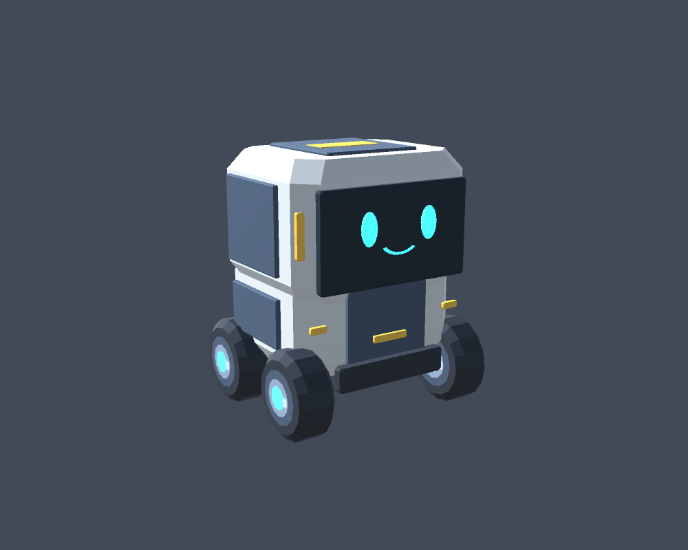
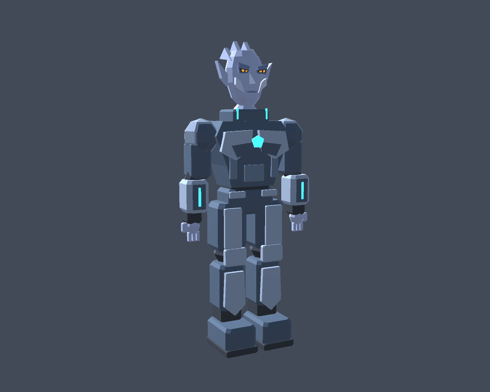

# Hafif karakter gövdeleri — 2 Kasım 2026

Kullanıcı tarafından onaylanan AX-7 ve Kael konseptleri sadeleştirilerek gerçek
3D mesh varlıklarına dönüştürüldü ve EscapeScene'e bağlandı. Kael'in portre
arayüzü değişmedi. Taslak resimler doğrudan oyun modeli değildir; modeller bu
görsellerden türetilen düşük poligonlu yorumlardır.

| Özellik | AX-7 | Kael |
| --- | --- | --- |
| Üçgen | 2160 | 4287 |
| MeshRenderer | 5 | 5 |
| Malzeme | İki karakterin paylaştığı 1 URP Lit malzeme | Aynı malzeme |
| Renk haritası | 128 × 8 piksel | Aynı renk haritası |
| Işıma haritası | 128 × 8 piksel | Aynı ışıma haritası |
| Geometri ölçüsü | 0.592 × 0.700 × 0.540 m | Yaklaşık 0.993 × 2.148 × 0.430 m, ayakta |

AX-7'nin dört tekerleği tek mesh varlığını paylaşır. İki karakter toplam
6447 üçgendir; yeni ışık, collider, rigidbody veya skinned mesh yoktur.
Gölge üretimi yeni renderer'larda kapalıdır. Runtime model üretimi yapılmaz.
Sayısal FPS ölçümü henüz yapılmadı; düşük yük hedefi gerçek laptopta doğrulanmalıdır.

## Bağlantılar

- AX-7: `AX-7` → mevcut görsel/çarpışma gövdesi → `AX7_LowPoly`.
- Kael: `Kael` → mevcut `visualBody` → `Kael_LowPoly`.
- Önceki küp/kapsül MeshRenderer'ları kapatıldı; collider'ları ve ölçekleri aynı kaldı.
- Yeni görseller mevcut görsel dönüşümlerinin ters ölçekli çocuklarıdır.
- Kael'in atmosfer olayı aynı `visualBody` ve CapsuleCollider üzerinde çalışır.
- `LightweightCharacterMotion` yalnızca gerçek `NavMeshAgent.velocity` ile tekerlek
  ve uzuv dönüşü üretir. Rota, hedef, ajan konumu veya görev kararı değiştirmez.
- Agent durduğunda uzuvlar dinlenme pozuna döner; Kael düşerken yürüme hareketi biter.
- Yeni görseller collider içermediği için Physics Colliders ile oluşturulan
  NavMesh'e yeni bir engel eklenmez; bu değişiklik için bake gerekmez.

## Doğrulama

Mesh'ler ayrı küçük bir Unity 6000.3.26f1 projesinde gerçek AssetDatabase importuyla
yüklendi ve standart stüdyo ışığında render edildi. Bu resimler ana sahnenin
URP ışıklandırması altında alınmış Play görüntüleri değildir.
Sahne karşılaştırmasında yalnızca iki eski renderer'ın görünürlüğü ve iki mevcut
görsel dönüşümün çocuk listesi değişti; eski fizik ve oyun bileşenleri aynı kaldı.
AX-7'nin tekerlek göbekleri dahil geometri sınırları mevcut 0.6 × 0.8 × 0.6 m
çarpışma gövdesinin içindedir. Girişteki alçak geçit yaklaşık 1.2 m yüksekliktedir.

Oyun içi tekrar kontrolü bekleyenler: AX-7'nin alçak geçitten panele gitmesi,
tekerleklerin hareket sırasında dönmesi, iki karakterin oyuncuyu takip etmesi,
Kael'in atmosfer olayında yeni gövdesiyle yere yatıp orada kalması,
geminin sonuna kadar oynanış ve laptopta akıcılık.

C# derleme kontrolü yeni görsel hareket bileşeni dahil başarılıdır. Son varlık
kontrolünde mesh veri uzunlukları, indeksler, normal vektörleri ve sahne GUID
bağlantıları doğrulandı. Ana projenin Play kontrolü henüz yapılmadı.
