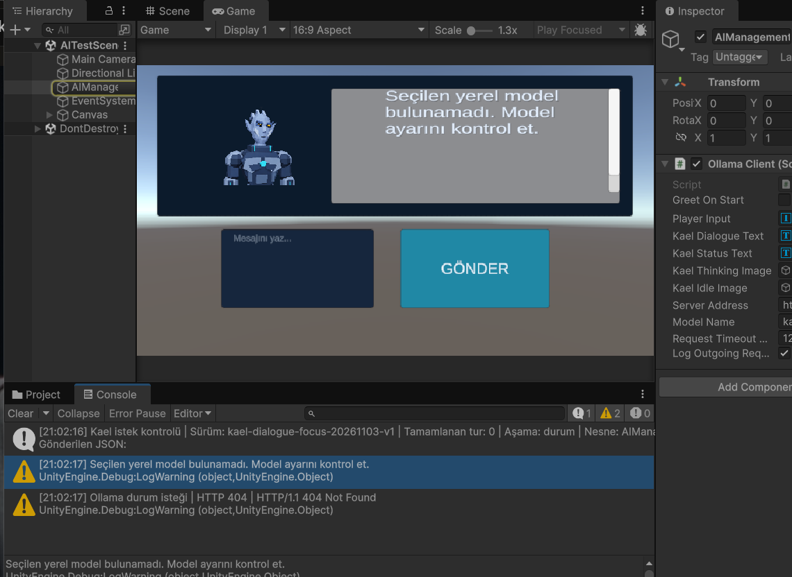
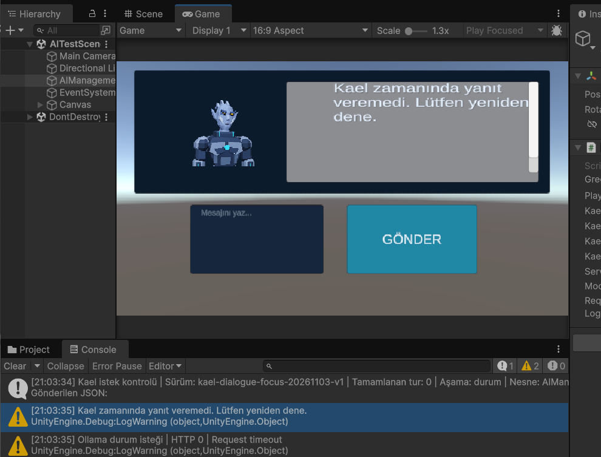
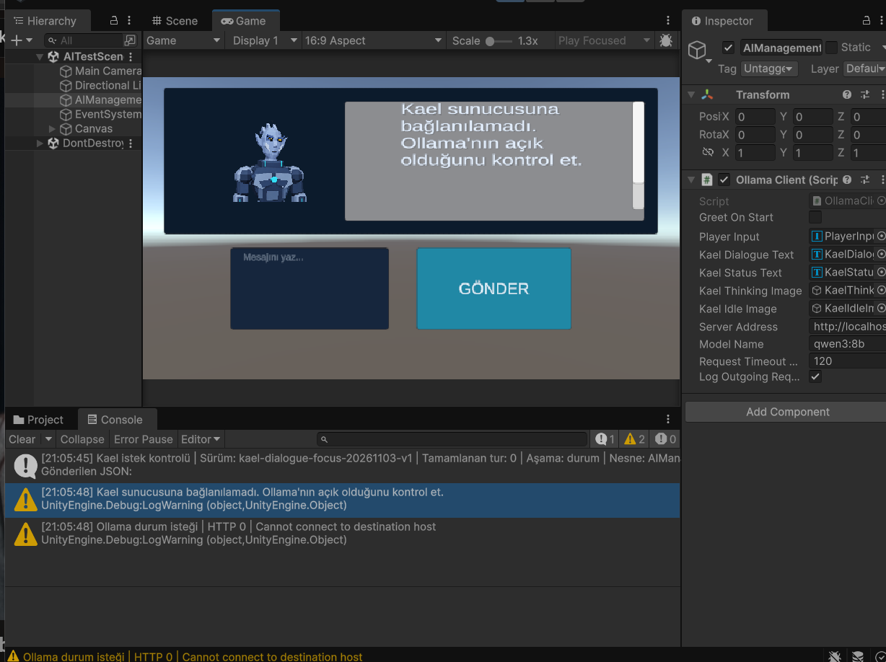

# Kael hata yönetimi — 3 Kasım 2026

Bağlantı kesintisi, bulunmayan model ve zaman aşımı daha önce aynı genel mesajı gösteriyordu. `OllamaClient` artık hatanın nedenine göre açıklama gösterir.

| Durum | Oyuncuya gösterilen mesaj |
| --- | --- |
| Bağlantı kesintisi | Kael sunucusuna bağlanılamadı. Ollama'nın açık olduğunu kontrol et. |
| Bulunmayan model | Seçilen yerel model bulunamadı. Model ayarını kontrol et. |
| Zaman aşımı | Kael zamanında yanıt veremedi. Lütfen yeniden dene. |
| Bulunmayan sunucu adresi | Kael sunucusunda istenen adres bulunamadı. Sunucu adresini kontrol et. |

Model hatası yalnızca HTTP 404 ve JSON `error` alanında `model` / `not found` açıklaması birlikte bulunduğunda seçilir. Her 404 model hatası sayılmaz. Diğer hatalar genel yeniden deneme mesajını korur. Console kaydında istek aşaması, HTTP kodu ve bağlantı ayrıntısı bulunur.

## Doğrulama

- 12 hata sınıflandırma kontrolü ve mevcut 54 protokol/bütünlük kontrolü geçti.
- Unity kütüphaneleriyle derlemede 0 hata; önceden var olan CS0649 uyarısı devam ediyor. Bu kontrol tam oyun derlemesi değildir.
- Kullanıcı, önceki genel mesajlarla üç hata türünü Unity Play oturumunda tetikledi; her birinden sonra aynı oturumda Kael yeniden normal yanıt verdi. Bağlantı kesintisinde donma olmadığı ve zaman aşımı sonrası kapının kapalı kaldığı bildirildi.
- Düzenleme sonrasında aşağıdaki üç yeni mesaj Unity'de ayrı ayrı görsel olarak doğrulandı; düşünme görseli kapanıp normal Kael görseline dönüldü.
- Model ayarı `qwen3:8b`, istek süresi `120` saniyedir. Testlerde geçici model adı ve 1 saniye süre kullanıldı.

[Otomatik test sonuçları ve manuel doğrulama kapsamı](KaelErrorHandlingTests-2026-11-03.json)

## Unity ekranları

### Bulunmayan model

### Zaman aşımı

### Bağlantı kesintisi

## Kapsam ve açık işler

Değişiklik yalnızca hata açıklamalarını ve hata ayrıntısının kaydını düzenler. Model, konuşma promptları, iki aşamalı akış, durum belleği ve kapı koşulları değiştirilmedi. AX-7 koduna dokunulmadı.

Yeni mesajlar sonrasında toparlanma testleri tekrar edilmedi. Bozuk veya eksik model yanıtlarının ve ikinci aşama hatalarının canlı Unity testi henüz tamamlanmadı. Bu rapor genel konuşma tutarlılığının veya tüm hata senaryolarının kusursuz olduğunu iddia etmez.
