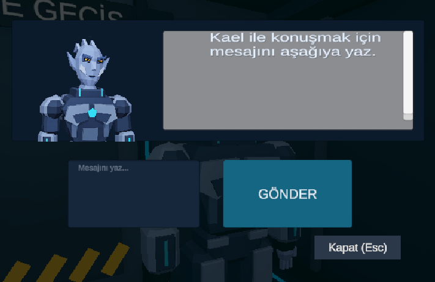
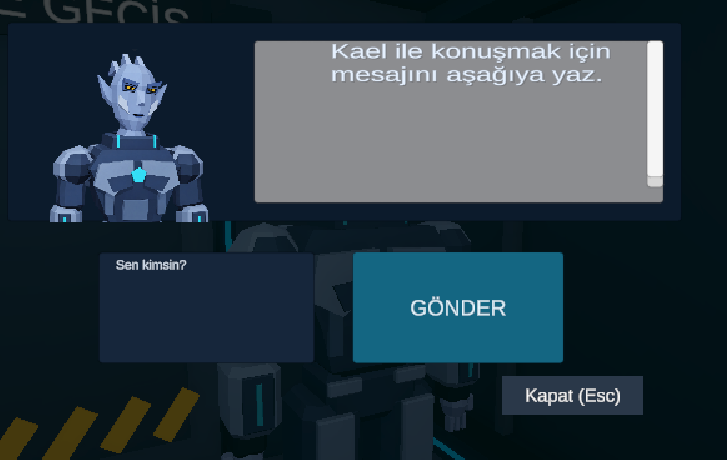
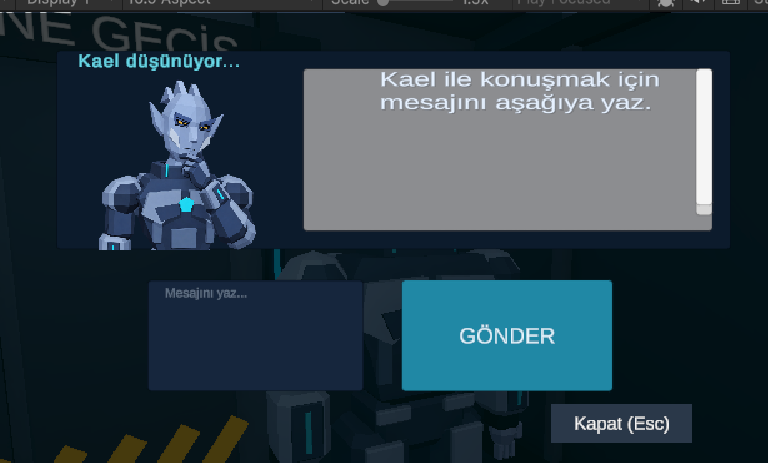
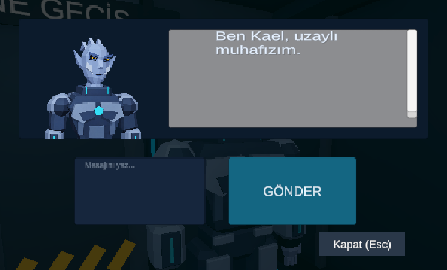
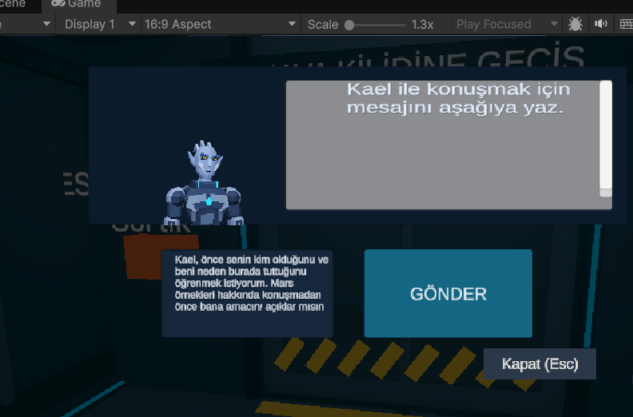
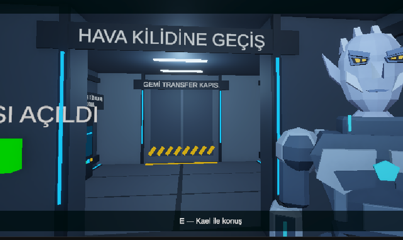

# Kael ana sahne testi ve güncel arayüz — 4 Kasım 2026

Bu rapor, kullanıcının `EscapeScene` içinde yaptığı manuel kontrolleri ve paylaştığı gerçek ekran görüntülerini belgeler. Ekranlar yeniden üretilmedi veya değiştirilmedi.

## Güncel büyük portreler

Normal ve düşünme portrelerinin boyutu 120 × 120 yerine 190 × 190 yapıldı; iki portre aynı konuma yerleştirildi. “Kael düşünüyor…” yazısı portre üstünde lacivert panelin içine alındı. Kullanıcı bu düzenin düzgün çalıştığını bildirdi.

### 1. Konuşma penceresinin açılışı

### 2. Mesajın yazılması

### 3. Yanıt beklenirken

### 4. Cevap sonrası normal portreye dönüş

## Ana sahnede tamamlanan kontroller

| Kontrol | Gözlem / sonuç |
| --- | --- |
| Pencereyi açma | Normal Kael portresi ve mesaj alanı görüntülendi. |
| Enter ile gönderme | Mesaj gönderildi, kutu temizlendi ve model cevabı gösterildi. |
| Bekleme durumu | Düşünme yazısı ve düşünme portresi açıldı; cevapta normal portreye dönüldü. |
| Esc ile kapatma ve E ile yeniden açma | Kullanıcı pencerenin düzgün yeniden açıldığını doğruladı. |
| Uzun mesaj | Metin sağa kaymak yerine alt satırlara geçti; Enter ile gönderildi. |
| Konum bilgisi | “Mars örnekleri benim gemimde.” mesajından sonra Kael getirme sözü istedi. |
| Konum ve teslim sözü | “Örnekleri sana getireceğim.” mesajından sonra Kael biyometrik kapıyı açtığını söyledi; gösterge yeşile döndü ve açık kapı görüntülendi. |
| Fiziksel geçiş | Kullanıcı kapı eşiğinden geçtiğini “geçtim” mesajıyla doğruladı. |

## Uzun mesaj testi

Mesaj kutusu `MultiLineSubmit` ve normal satır kaydırma ayarıyla çalışır. Uzun metin otomatik olarak alt satıra geçer; Enter gönderir. Aşağıdaki kanıt portre büyütülmeden önce alınmıştır; güncel görsel tasarım olarak yukarıdaki dört ekran esas alınmalıdır.

## Gerçek kapı açılışı ve geçiş

Konum ve teslim sözü sonrası konuşma penceresi kapatıldı; Kael'in koruduğu geçidin açık olduğu görüldü. Kullanıcı yürüyerek geçtiğini ayrıca doğruladı. Bu görüntü portre büyütme işleminden önceki test akışındandır; konuşma paneli kapalıdır.

## Kod ve hata yönetimi testleriyle ilişki

Önceki kod kontrollerinde 54 protokol kontrolü, 12 hata mesajı kontrolü, 44 başarısız tur/yeniden deneme senaryosu ve 756 doğrulama geçti. Ekran sorumluluğu ayrımında 120 istek örneği önceki sürümle birebir aynı bulundu. Bunlar ayrı tarihlenmiş kod testleridir; bu ekranlar için yeni bir otomatik model başarı oranı hesaplanmadı.

[Ekran ayrımı ve otomatik test kapsamı](KaelViewSeparation-2026-11-03.md) · [Hata ekranları ve testleri](KaelErrorHandling-2026-11-03.md) · [Bu manuel testin kayıtları](KaelUIPlayTests-2026-11-04.json)

## Kalan kontroller ve sınırlar

Bu kayıt Unity Play içindir; Unity dışında alınmış oyun sürümünü veya tüm ekran oranlarını doğrulamaz. Kael'in ara sıra rol karıştırması ve genel konuşma akıcılığı bilinen sınırlardır. Bozuk/eksik yanıt testleri kod akışında çalıştırıldı; ikinci aşama ağ hatasının canlı Unity testi tamamlanmış sayılmaz. AX-7/NavMesh ölçümleri bu raporun kapsamı dışındadır.
