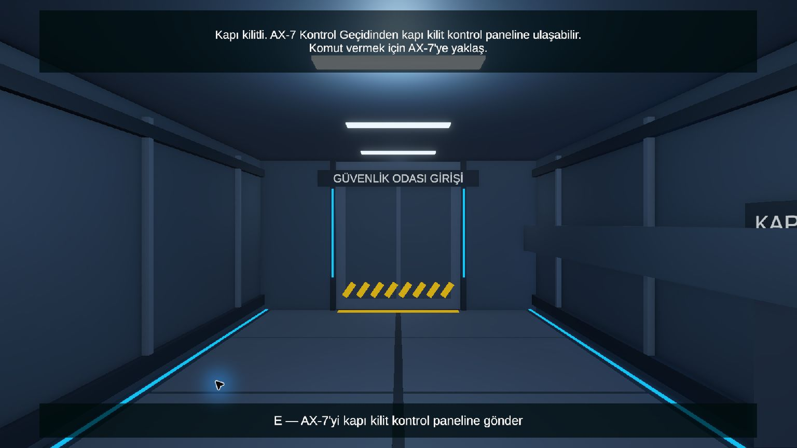

# Windows oyun sürümü ve doğrulama

**Belge güncellemesi:** 5 Kasım 2026. Testler ve derlemeler 4 Kasım 2026 tarihlidir. Bu güncelleme belge açıklamalarını düzeltir; yeni derleme veya yeni oyun testi yapıldığı anlamına gelmez.

## Güncel dağıtım

Son doğrulanan çıktı `Builds/Windows-20261104-final/UzayGemisindenKacis.exe` ve yanındaki çalışma zamanı dosyalarıdır. Unity **6000.3.26f1**, Windows Intel 64-bit, Development Build kapalı olarak `4726718` kaynak sürümünden derlendi. Unity sonucu **Succeeded**: 4 Kasım 16:32:18–16:32:51, yaklaşık 33 saniye.

- [Yayımlanan Windows sürümü — v1.0.0](https://github.com/eminenurkazan/uzay-gemisinden-kacis-oyunu/releases/tag/v1.0.0)
- [Windows x64 ZIP dosyası](https://github.com/eminenurkazan/uzay-gemisinden-kacis-oyunu/releases/download/v1.0.0/UzayGemisindenKacis-Windows-x64-v1.0.0.zip)
- [SHA-256 bütünlük dosyası](https://github.com/eminenurkazan/uzay-gemisinden-kacis-oyunu/releases/download/v1.0.0/SHA256SUMS.txt)

GitHub'daki ZIP 42.102.022 bayttır. GitHub'ın hesapladığı SHA-256 özeti, yerel doğrulanmış paketin özetiyle eşleşmiştir. Paketlenen oyun ile sürüm etiketinin işaret ettiği sonraki rapor commitleri arasında oyun kodu değişmemiştir. `Builds/` kaynak depoda tutulmaz; oyun paketi Releases üzerinden ayrıca indirilir. Önceki yerel derlemeler korunmuştur.

## Güncel derlemede uçtan uca doğrulama

Ekip üyesi normal oyun kontrolleri ve gerçek yerel Ollama / `qwen3:8b` ile tek bir Windows oynanış oturumunu tamamladı. Altı özgün ekran görüntüsü ve aynı derlemenin `Player.log` kaydı birlikte incelendi:

| Aşama | Sonuç |
| --- | --- |
| AX-7 fiziksel kapı görevi | Robot panele ilerledi; testi yürüten ekip üyesi ilk kapının sorunsuz açıldığını doğruladı ve Kael alanına ulaştı. |
| Yalnızca örnek konumu | `PLAYER_SHIP/UNKNOWN`, `NONE`; biyometrik kapı kapalı kaldı. |
| Örnekleri Kael'e verme sözü | `PLAYER_SHIP/ACCEPTED`, `OPEN_DOOR`; Kael “Kapıyı biyometrik yetkimle açıyorum.” dedi ve fiziksel kapı tamamen açıldı. |
| Atmosfer | Kael hava kilidine geldi; panel işlemi tamamlandı ve Kael etkisizleşti. |
| Gemiye giriş | AX-7 dışarıda kalacağını bildirdi; gemi kapağı açıldı ve oyuncu tamamen kokpite girdi. |
| Acil ayrılma | İç panelle kapak tamamen kapandı, 3 saniyelik geri sayım başladı ve başarı ekranına ulaşıldı. |

[Altı ekran görüntüsü, adım bazında kanıt ve kapsam](../README.md#güncel-windows-sürümünde-uçtan-uca-oynanış-testi--4-kasım-2026) ana rapordadır. Bu tek oturum sayısal başarı oranı veya performans tekrarı değildir. Uzun metnin satır kaydırması ve Enter/E/Esc kontrollerinin önceki Unity Play kanıtları [arayüz raporunda](KaelUIPlayTests-2026-11-04.md) tutulur; bunlar her derlemede yeniden ölçülmüş sayılmaz.

## NavMesh başlangıcı: eski uyarılar ve son düzeltme

Erken Windows derlemelerinde AX-7/Kael ajanları yüzeyler hazır olmadan etkinleştiği için başlangıç uyarıları görülmüştü. Son derlemenin kaynakları `NavMeshAgentStartup` düzeltmesini içerir: ajanlar kendi türlerine uygun başlangıç zemini doğrulandıktan sonra etkinleştirilir. Eski uyarı gözlemleri aşağıdaki erken sürümlere aittir; güncel sürümün devam eden sorunu olarak sunulmaz.

Ayrı Windows tanı uygulamasında düzeltilmiş başlangıçla **0 uyarı** ve iki bağlı ajan doğrulandı; gerçek sahne kopyasındaki 29 otomatik işlev kontrolü başlangıç bağlantısını da kapsadı. Bunlar bütün bilgisayarlarda uyarı olmayacağı garantisi değildir. [Başlangıç tanısı ve sonuçları](NavMeshStartup-2026-11-04.md) · [AX-7 işlev kontrolleri](AX7Measurements/Functional-Tests-2026-11-04.md).

## Pencere, çıkış ve 60 FPS hedefi

Başlangıç ayarı 1280×720, yeniden boyutlandırılabilir penceredir; Windows/Unity önceki ekran tercihlerini saklayabilir. **F1** seçenekler menüsünü, **F11** pencere/tam ekran geçişini açar. Menüde **Tam ekran**, **Pencere**, **Geri dön** ve **Oyundan çık** düğmeleri vardır. Menü açıkken oyuncu hareketi/kamera, giriş hikâyesini ilerletme ve Kael etkileşim tuşları engellenir; dünya simülasyonu duraklatılmaz.

Menünün ilk Windows derlemesinde pencereli açılış, menü düğmesi, Tam ekran/Pencere geçişi ve çıkış düğmesinin uygulamayı kapatması otomasyonla doğrulandı; ekip üyesi de çalıştığını doğruladı. F1/F11 kısa otomasyon tuş girişleriyle ayrıca doğrulanamadı; düğmelerin kontrolü tamamlandı. Son derlemenin uçtan uca oynanış kanıtı yukarıda ayrıca sunulur.

`GameFrameRateLimit`, oyun başlarken `Application.targetFrameRate = 60` uygular; sahnedeki bir nesneye elle bağlamak gerekmez. Bu üst sınır hedefidir, sürekli gerçek 60 FPS ölçümü değildir. Yerel LLM ve oyunun aynı ekran kartını kullanırken gereksiz görüntü üretimini sınırlamak amaçlandı.

## Önceki derlemeler ve gecikme ölçümünün kapsamı

| Önceki yerel çıktı | 4 Kasım derleme sonucu | Kapsam |
| --- | --- | --- |
| `Windows-20261104` | Succeeded, yaklaşık 113 saniye | İlk ayrı uygulama başlangıç kontrolü; sonraki giriş ekranı ve performans düzenlemelerinden önce. |
| `Windows-20261104-60fps` | Succeeded, yaklaşık 22 saniye | 60 FPS hedefi; kimlik/konum/teslim konuşmaları ve kapı kontrolü. |
| `Windows-20261104-merged-60fps` | 14:45:39–14:46:03, Succeeded, yaklaşık 25 saniye | Hikâye ve galaksi ekranı güncellemeleri sonrası kapıdan geçiş. |
| `Windows-20261104-window-menu` | 14:58:29–14:58:44, Succeeded, yaklaşık 15 saniye | Pencere ve çıkış düğmeleri; NavMesh başlangıç düzeltmesinden önce. |

Son üç satırdaki erken sürümler güncel dağıtım olarak kullanılmaz; güncel çıktı belgenin başındaki `Windows-20261104-final` sürümüdür.

Birleştirme öncesi `Windows-20261104-60fps` uygulamasında konum turunun iki HTTP aşaması 2,48 s + 0,77395 s = yaklaşık **3,25 s**, teslim turu 2,5 s + 0,59 s = **3,09 s** sürdü. Bunlar Ollama sunucu işlem sürelerinin toplamıdır; tam kullanıcı bekleme süresi veya FPS ölçümü değildir. Güncel final derlemesinde gecikme yeniden ölçülmedi. İlk model yüklenmesi ve donanım süreyi değiştirebilir.

Erken konum testinde model ham çıktıda ACCEPTED önerse de teslim alıntısı boş olduğu için oyun doğrulaması UNKNOWN tuttu; erken kapı açılmadı. Bununla birlikte alan/alıntı doğrulaması tüm anlam hatalarını engellemez. Yönlendirici bir sistem talimatının yanlış teslim sözü sayılabildiği önceki örnek, [ana raporda](../README.md#sonuç-ve-tartışma) bilinen model sınırı olarak belirtilir.

### Tarihsel başlangıç görüntüsü

Bu görüntü ilk derlemeye aittir; güncel sürümün açılış ekranı veya NavMesh test kanıtı değildir.

## Başka bilgisayarda çalıştırma ve istek sınırları

ZIP'in tamamını bir klasöre çıkarıp EXE'yi o klasörden çalıştırın. `_Data`, `MonoBleedingEdge`, `D3D12`, `UnityPlayer.dll` ve diğer gerekli çalışma zamanı dosyaları birlikte kalmalıdır. `DoNotShip` hata ayıklama klasörü dağıtım paketine dahil değildir. Paket içindeki `CALISTIRMA.txt` adımları açıklar.

Aynı bilgisayarda Ollama açık ve `qwen3:8b` modeli kurulu olmalıdır; model ağırlıkları pakete dahil değildir. Kael varsayılan olarak `http://localhost:11434/api/chat` adresini kullanır. Her HTTP isteğinin zaman aşımı 120 saniyedir. Durum ve konuşma istekleri ardışık olduğundan bu değer toplam konuşma turu için ortak sınır değildir.

İlk durum yanıtı doğrulanınca kapı kararı hesaplanır; ikinci konuşma yanıtı da doğrulanınca durum kaydedilip karar olayı yayımlanır. İkinci aşama başarısızsa önceki durum korunur ve yeni kapı kararı uygulanmaz. Oyundan menüdeki çıkış düğmesi veya Alt+F4 ile çıkılabilir.
