# Uzay Gemisinden Kaçış Oyunu

**Yazılım Geliştirme Laboratuvarı-I / Proje 1**
**Ekip:** Eminenur Kazan, Zülal Şahin
**Rapor tarihi:** 4 Kasım 2026
**Durum:** Son teslim raporu; ölçüm sonuçları ve güncel Windows sürümünün uçtan uca oynanış doğrulaması dahil.

## Amaç ve oyun senaryosu

Bu proje, Unity üzerinde gerçek NavMesh yol bulması kullanan otonom bir yardımcı robot ile yerel büyük dil modeline bağlı bir NPC'yi tek macera oyununda birleştirir. Karar mantığı, çevre algısı, asenkron iletişim ve yapılandırılmış oyun eylemleri ayrı sorumluluklarla tasarlanmıştır.

İnsan astronot Mars'tan araştırma örnekleri toplamış, örnekleri kendi gemisinde saklamıştır. Uzaylı muhafız Kael astronotu kaçırmıştır; örneklerin yerini öğrenmek ve onları kendi türünün araştırmaları için almak ister. Oyuncunun amacı Kael'in gemisinden kendi gemisine dönerek kaçmaktır.

Oyun sırası:

1. Giriş hikâyesi cümle cümle gösterilir; Space/Enter ile ilerlenir.
2. Oyuncu kilitli fiziksel kapıya ulaşır. AX-7'ye yaklaşarak E ile komut verir; robot oyuncunun giremediği alçak Kapı Kontrol Geçidi'nden gerçek rota hesaplayarak kapı kilit kontrol paneline ulaşır ve kapıyı açar.
3. AX-7 oyuncuyu takip eder. Oyuncu Kael ile serbest metin üzerinden konuşur. Örneklerin oyuncunun gemisinde olduğu bilgisi ve onları Kael'e getirme sözü doğrulanınca biyometrik kapı açılır.
4. Kael hava kilidine kadar oyuncuyu takip eder. Oyuncu Atmosfer Düzenleme Noktası'nı kullanır; Kael tamamen içerideyse işlem tamamlanır ve Kael etkisizleşir.
5. AX-7 gemi dışındaki bekleme noktasına giderek vedalaşır. Oyuncu kendi gemisine geçer, içerideki panelden kapıyı kapatır ve konsoldan acil ayrılmayı başlatır.
6. Geri sayım ve ekran geçişi ardından galaksi arka planlı başarı ekranı gösterilir. AX-7 oyuncunun gemisine girmez.

## Teknolojiler, kurulum ve kontroller

- Unity **6000.3.26f1**, C#, URP, Input System, TextMesh Pro.
- Unity AI Navigation / NavMesh ve Physics Raycast.
- Kael için yerel **Ollama / qwen3:8b**; bulut LLM API'si kullanılmaz.
- Git/GitHub sürüm yönetimi; Markdown raporu ve Mermaid diyagramları.

Unity projesini bu sürümle açın, derlemenin tamamlanmasını bekleyin ve `Assets/Scenes/EscapeScene.unity` sahnesini açın. Build başlangıç sahnesi de EscapeScene'dir. Normal oynanışta `SensorTestEngeli` kapalı olmalıdır. Kayıtlı NavMesh dosyaları projededir; geometri değiştirilirse **Uzay Oyunu > AX-7 NavMesh Hazırla** ile yeniden hazırlanır.

Kael'i çalıştıracak bilgisayarda Ollama açık ve `qwen3:8b` modeli kurulu olmalıdır. İstemci varsayılan olarak `http://localhost:11434/api/chat` adresini kullanır; istek zaman aşımı 120 saniyedir. Ollama ve model ağırlıkları GitHub projesi veya oyun build'iyle otomatik gelmez. AX-7 testleri model kurulumu gerektirmez.

| Kontrol | İşlev |
| --- | --- |
| Space / Enter | Giriş hikâyesinde sonraki cümle / oyuna başlama |
| WASD / fare | Yürüme / etrafa bakma |
| E | Yakındaki robot, Kael, panel veya konsolla uygun etkileşim |
| Enter | Kael konuşma alanında mesaj gönderme |
| Esc | Diyaloğu kapatma / fareyi serbest bırakma |
| Oyun alanına tıklama | Oyun kontrolünü geri alma |
| F1 / F11 | Oyun seçenekleri menüsü / pencere ve tam ekran arasında geçiş |
| Menü > Oyundan çık | Uygulamayı kapatma |

Son doğrulanan yerel Windows çıktısı `Builds/Windows-20261104-final/UzayGemisindenKacis.exe` dosyasıdır. `Builds/` Git tarafından dışlanır; hazır oyun aşağıdaki GitHub Releases bağlantısından ayrıca indirilir. Proje Unity üzerinden EscapeScene başlangıç sahnesiyle yeniden derlenebilir.

`GameFrameRateLimit` hedef kare hızını 60 FPS ile sınırlar. Bu ayar her bilgisayarda gerçek 60 FPS elde edildiği veya ölçüldüğü anlamına gelmez. Windows dağıtımında EXE, `_Data`, `MonoBleedingEdge`, `UnityPlayer.dll` ve gerekli diğer build dosyaları birlikte tutulmalıdır. [Windows build ve menü testleri](Docs/KaelWindowsBuild-2026-11-04.md).

## Hazır Windows sürümünü indirme

**[Windows 64-bit oyunu indir — v1.0.0](https://github.com/eminenurkazan/uzay-gemisinden-kacis-oyunu/releases/download/v1.0.0/UzayGemisindenKacis-Windows-x64-v1.0.0.zip)** · [GitHub Releases sayfası](https://github.com/eminenurkazan/uzay-gemisinden-kacis-oyunu/releases/tag/v1.0.0) · [SHA-256 bütünlük dosyası](https://github.com/eminenurkazan/uzay-gemisinden-kacis-oyunu/releases/download/v1.0.0/SHA256SUMS.txt)

1. ZIP dosyasını indirin ve **tamamını** bir klasöre çıkarın.
2. Aynı bilgisayara [Ollama](https://ollama.com/download/windows) kurun; `ollama pull qwen3:8b` ile modeli indirin ve Ollama'yı açık tutun. Model indirme internet gerektirir; sonrasında Kael yerel sunucuyla çalışır.
3. Çıkarılan klasördeki `UzayGemisindenKacis.exe` dosyasını çalıştırın. EXE'yi yanındaki `_Data`, `MonoBleedingEdge`, `D3D12` ve DLL dosyalarından ayırmayın. Paket içindeki `CALISTIRMA.txt` kurulum ve kontrolleri açıklar.

Ollama ve model ağırlıkları ZIP'e dahil değildir. Donanım, modelin çalışabilirliğini ve yanıt süresini etkiler. Paket, bu raporda uçtan uca test edilen `4726718` kaynaklı 4 Kasım 2026 16:32 Windows derlemesidir; sürüm etiketi sonraki rapor güncellemelerini de içerir. Bu aralıkta oyun kodu değişmemiştir. Oyun paketi GitHub Releases varlığıdır; kaynak depo içine eklenmemiştir. `DoNotShip` hata ayıklama klasörü dağıtıma dahil edilmedi.

## OOP tasarımı ve sorumluluklar

| Bileşen / arayüz | Sorumluluk |
| --- | --- |
| `AstronautController`, giriş bileşenleri | Oyuncu hareketi/kamera ve etkileşim tuşları |
| `AX7Brain` | Fiziksel kapı görevinin durum makinesi |
| `INavigationMotor` / `NavMeshMovement` | Gerçek rota, varış, durma, duraklatma ve sürdürme |
| `IObstacleSensor` / `ObstacleSensor` | Engel adı, mesafesi ve açısını Raycast ile algılama |
| `IInteractable` / `ControlPanel` | Robot yetkisi, yakınlık ve panel/kapı etkileşimi |
| `IOpenableDoor`, `IClosableDoor` / `DoorController` | Kapının gerçek açılma/kapanma durumu |
| `AX7FollowPlayer`, `AX7Farewell` | Görev sonrası takip ve gemi dışında bekleme kararları |
| `NavMeshAgentStartup` | Yüzeyler hazır olduktan sonra türe uygun başlangıç zeminini doğrulama |
| `OllamaClient` | Asenkron yerel HTTP istekleri ve konuşma oturumu |
| `KaelConversationState` içindeki protokol/politikalar | Yapılandırılmış durumu, dayanakları, konuşmayı ve kapı koşulunu doğrulama |
| `IKaelDecisionSource` / `BiometricDoorLink` | Doğrulanmış NPC kararıyla fiziksel kapı arasında olay bağlantısı |
| `KaelDialogueView`, `CompanionHUD` | Diyalog ve görev arayüzü; karar üretmezler |
| `IAtmosphereControl`, `IAtmosphereTarget` | Atmosfer paneli ile Kael tepkisi arasındaki sözleşmeler |
| `ShipAccessController`, `IShipAccess` | Gemiye giriş, tamamen içeride olma ve kapatma ön koşulları |
| `ShipDepartureController`, `IShipDeparture` | Acil ayrılma sırası ve tamamlanma durumu |
| `EscapeIntroView`, `EscapeEndingView` | Giriş/son ekran ve kontrol kilidi |
| `GameWindowMenu`, `GameFrameRateLimit` | Pencere/tam ekran ve çıkış seçenekleri; başlangıç kare hızı sınırı |

Karar, hareket, algılama, etkileşim ve sunum tek bir GameManager içine toplanmamıştır. AX-7 motor/sensör/paneli arayüzler üzerinden kullanır; panel kapıyı sözleşmesi üzerinden açar. Inspector bağlantıları somut uygulamaları seçer. Oyun durumları dışarıya salt okunur özelliklerle açılır; Kael kararı ve atmosfer tamamlanması olaylarla iletilir. Bu ayrım soyutlama, kapsülleme ve sorumluluk ayrımını destekler. Unity Inspector bağlantıları bileşenlerin sahneye atanmasını sağlar; `OllamaClient` HTTP ve konuşma oturumunu koordine ederken görünüm işlemleri `KaelDialogueView` içinde tutulur. [Kael görünüm sorumluluğunun ayrılması](Docs/KaelViewSeparation-2026-11-03.md).

## AX-7: gerçek yol bulma, sensör ve karar mantığı

`NavMeshMovement`, ajan türüne uygun hedef zemini bulur; `CalculatePath` ile tam rota doğrular ve `SetPath` ile NavMeshAgent'a verir. AX-7 için önceden yazılmış yürüyüş dizisi veya varışı taklit eden Transform hareketi kullanılmaz. Kapılar sabit NavMesh geometrisine pişirilmez; kapalıyken carving engeli oluşturur, tamamen açıldığında engel kalkar. Robot kendi rotasını gerçek çalışma zamanı haritasından hesaplar.

Sensör robotun önünden bir sonraki rota köşesine doğru üç paralel Raycast gönderir. Kendi gövdesi ve trigger collider'lar dışlanır. Görev sırasında engel algılanınca rota silinmeden durulur; engel kalkınca devam edilir. Kalıcı engelde 20 saniye sonra kontrollü başarısızlık oluşur. Görev sürerken ek E komutu yok sayılır; başarı yalnız kapı tamamen açıldığında oluşur.

| Ayar | Değer |
| --- | ---: |
| AX-7 ajan yarıçapı / yüksekliği | 0,35 / 0,8 birim |
| Ajan hızı | 2 birim/sn |
| Komut mesafesi | Yatay 3 birim |
| Raycast üst mesafesi / başlangıç yüksekliği | 0,9 / 0,4 birim |
| Yan ışınların merkezden uzaklığı | 0,24 birim |
| Engel bekleme / ilerleyememe sınırı | 20 / 6 saniye |
| Hareket zaman sınırı | Sensörde bekleme hariç 45 saniye |
| Takip durma / yeniden başlama mesafesi | 1,6 / 2,3 birim |

### Fiziksel kapı görevi durum makinesi

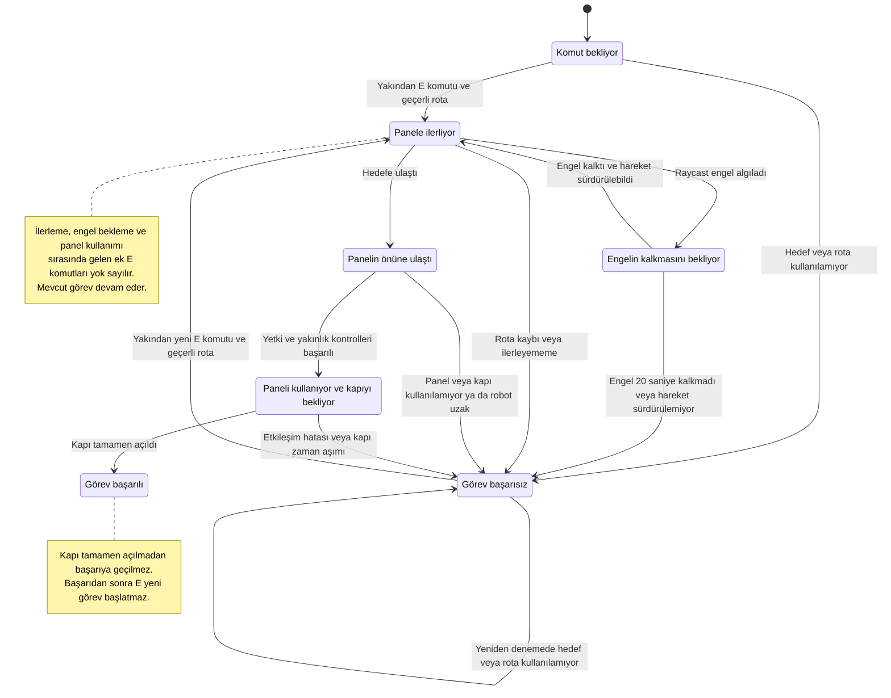

### Takip ve vedalaşma

Başarılı panel görevi sonrası `AX7FollowPlayer` motoru devralır; oyuncuya yaklaşınca durur ve oyuncu uzaklaşınca hedefi yeniden hesaplar. Açık ilk kapıdan geçiş gerçek NavMesh rotasıyla yapılır. Raycast takipte engel görürse durulur; engel kalkınca devam edilir. Rota bulunamazsa tekrar denenir.

Kael etkisizleştiğinde `AX7Farewell` takibi kapatır ve ortak motoru devralır; iki karar bileşeni aynı anda hedef yazmaz. Hedef, dünya konumu yaklaşık (2; 0,025; 11,6) olan `HavaKilidi/AX7BeklemeNoktasi`dır. `KaelFallenObstacle` yerdeki gövdenin collider sınırını carving engeli olarak NavMesh'e bildirir; robot gerektiğinde gerçek alternatif rota hesaplar. Oyuncunun gemisi `NavMeshModifierVolume` ile ajanlar için Not Walkable'dır. Gerçek varıştan sonra robot dışarıda bekler.

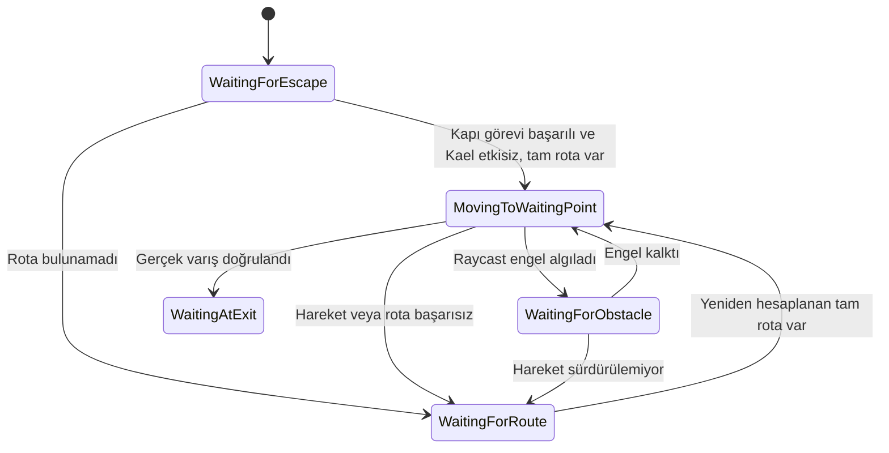

## AX-7 ölçüm sonuçları — 4 Kasım 2026

Her koşulda üç bağımsız Play oturumu kullanıldı. Kullanıcı E ile komut verdi; editör ölçüm penceresi başlangıç konumunu, görev durumlarını, sonucu, süreleri, engelde beklemeyi, kapı durumunu ve Git commit'ini CSV'ye kaydetti. Ölçüm E komutunun kabulünden terminal duruma kadardır; hikâye süresi dahil değildir. Panel etkileşimi ve kapı açılışı dahil toplam görev süresidir, saf yürüme süresi değildir. Aynı laptop kullanıldı; timeScale=1 ve 60 FPS hedef sınırı korundu, ölçüm sırasında duraklatma yapılmadı.

| Test | Başlangıç / koşul | Üç toplam oyun süresi (sn) | Ortalama (sn) | Sonuç |
| --- | --- | --- | ---: | --- |
| A1 — normal başlangıç | X=1,5; Y≈0,025; Z=-12; engel kapalı | 8,578 / 8,555 / 8,581 | **8,571** | 3/3 görev başarılı (%100) |
| A2 — alternatif başlangıç | X=0; Y≈0,025; Z=-10; engel kapalı | 8,656 / 8,633 / 8,629 | **8,639** | 3/3 görev başarılı (%100) |
| B1 — geçici engel | Normal başlangıç; sensör beklemesinden yaklaşık 5 sn sonra engel kaldırıldı | 14,168 / 14,035 / 13,985 | **14,063** | 3/3 bekleme sonrası devam ve başarı (%100) |
| B2 — kalıcı engel | Normal başlangıç; engel kaldırılmadı | 23,043 / 23,057 / 23,046 | **23,049** | 3/3 beklenen kontrollü Failed; kapı kapalı |

B2'de **görev başarı oranı 0/3**, beklenen güvenli başarısızlık davranışının doğrulanma oranı **3/3**tür. Engel algılandıktan sonraki beklemeler 20,007 / 20,009 / 20,006 saniyedir; toplam süre engele kadar ilerlemeyi de içerir.

B1'in ana tekrarlarındaki gerçek beklemeler 5,572 / 5,457 / 5,425 saniyedir. Engelin elle kaldırılma farkı toplam süreyi etkiler. **B1-07** başarılı bitmiş ancak kullanıcı engeli yanlışlıkla 3,051 saniyede kaldırmıştır; toplam 11,499 saniyelik bu deneme ham kayıtta korunmuş, ana ortalamadan çıkarılmıştır. Otomatik `valid_for_stats=1` teknik kontrolleri belirtir; protokol dışı tutma kararı ayrı seçim dosyasındadır.

**Sürüm bilgisi:** A1/A2 `413c827`; B1/B2 `b6d1ab7` (NavMesh başlangıç sırası düzeltmesi sonrası). Gruplar aynı bilgisayarda fakat belirtilen iki sürümde ölçülmüştür; tek sürümün birleşik performans deneyi olarak sunulmaz. Eski 2 Kasım kayıtları tarihli belgelerde korunur; yukarıdaki ortalamalara katılmaz.

- [13 ham kayıt: 12 ana deneme + 1 protokol sapması](Docs/AX7Measurements/Raw/ax7-20261104-151206-509.csv)
- [Özet CSV](Docs/AX7Measurements/Summary-2026-11-04.csv) · [Deneme seçim kararları](Docs/AX7Measurements/TrialSelection-2026-11-04.csv)
- [Ayrıntılı ölçüm yöntemi ve sonuçlar](Docs/AX7Measurements/Results-2026-11-04.md) · [Test planı](Docs/AX7Measurements/TestPlan.md)

**Alternatif başlangıç konumu:**

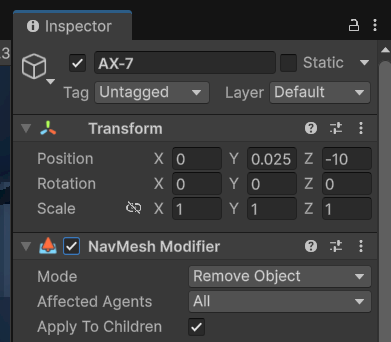

**Geçici engel kaldırılınca görevin tamamlanması:**

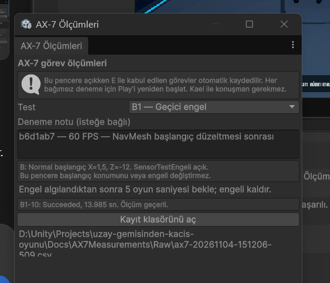

**Kalıcı engelde kontrollü başarısızlık:**

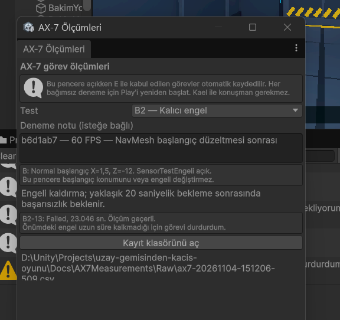

### Ek otomatik AX-7 işlev kontrolleri

`b6d1ab7` kaynakları, gerçek EscapeScene ve pişirilmiş NavMesh dosyalarıyla ayrı Unity Editor Play kopyasında yapılan son koşuda **29/29 kontrol geçti**. Bu sayı 29 bağımsız performans tekrarı değildir; tek tamamlanan akış içindeki doğrulamalardır.

| Kontrol grubu | Doğrulanan sonuç |
| --- | --- |
| Başlangıç | AX-7 ve Kael kendi türlerine uygun NavMesh'e bağlı; ajan oluşturma uyarısı yok |
| Tekrar komut | Çalışan göreve 20 ek çağrı görevi yeniden başlatmadı veya başarısız yapmadı; komut uygunluğu kapalı kaldı |
| Başarı sonrası komut | 10 ek çağrı yeni görev oluşturmadı; tek başarı olayı ve tek kapı açılışı |
| Kapıdan takip | Robot ilk kapının düzlemini gerçek açıklık içinden geçti; bakım geçidini seçmedi |
| Mesafe davranışı | Yakında durdu; oyuncu devam eşiği dışına çıkınca takip etti; tekrar yakında durdu |
| Takipte Raycast | Geçici fizik engelinde durdu ve sabit kaldı; engel kaldırılınca devam etti |
| Kael ve atmosfer | Kael tamamen hava kilidine girdi; gerçek panel olayı etkisizleşmeyi başlattı |
| Vedalaşma | AX-7 takibi bırakıp gerçek NavMesh ile bekleme noktasına ulaştı; düşen Kael gövdesiyle rota çalıştı |
| Geminin dışında kalma | Oyuncu gemideyken AX-7 dışarıda WaitingAtExit kaldı; ölçülen konum değişimi 0; kokpit AX-7 için yürünebilir değil |

Oyuncunun konumu test düzeneğiyle değiştirildi; AX-7 konumu/durumları elle atanmadı. Klavye E fiziksel olarak simüle edilmedi; E'nin kullandığı görev metodu ve `CanIssueCommand` koşulu sınandı. Kael konuşmasına Ollama isteği gönderilmedi: mevcut editör test girişi yalnız izole kopyada biyometrik kapıyı açtı. Sonrasında gerçek takip, atmosfer, düşme, vedalaşma ve kapak ön koşulları çalıştı. Üretim sahnesine test düğmesi eklenmedi. Bu kontroller LLM testlerinin veya Windows'ta uçtan uca ortak testin yerine geçmez.

[İşlev testi raporu](Docs/AX7Measurements/Functional-Tests-2026-11-04.md) · [29 kontrolün sonucu](Docs/AX7Measurements/Functional-Audit-2026-11-04.txt) · [Günlük kanıtı](Docs/AX7Measurements/Functional-Evidence-2026-11-04.txt) · [Tekrarlanabilir test yürütücüsü](Docs/AX7Measurements/Automation/AX7FunctionalAuditRunner.cs)

### NavMesh başlangıç düzeltmesinin doğrulanması

AX-7 ve Kael sahnede etkin ajan olarak başlatıldığında yüzey verileri yüklenmeden yerel ajan oluşturma uyarıları oluşuyordu; sonradan bağlanmaları bu açılış sorununu gizliyordu. İki ajan sahnede kapalı tutulup `NavMeshAgentStartup.Start` içinde türe uygun yakın başlangıç zemini doğrulandıktan sonra etkinleştirilir. Uygun zemin yoksa ajan kapalı kalır ve karakter adı/türü/konumuyla hata verilir; yol bulma taklit edilmez.

Aynı NavMesh verileriyle ayrı Windows tanı uygulamasında önceki yöntemde AX-7 tek başına 2, Kael tek başına 1, birlikte 3 uyarı üretti. Düzeltilmiş yöntemde **0 uyarı** ve iki bağlı ajan doğrulandı. Tam sahne kopyasındaki 29 kontrol de başlangıç bağlantısını doğruladı. [Tanı yöntemi ve sonuçları](Docs/NavMeshStartup-2026-11-04.md).

### Ölçümleri tekrarlama

1. Play dışında AX-7 başlangıç konumunu A1/B1/B2 için (1,5; yaklaşık 0,025; -12), A2 için (0; yaklaşık 0,025; -10) ayarlayın. NavMeshAgent'ın Play dışında kapalı olması yeni başlangıç düzeninin gereğidir; elle açmayın.
2. A1/A2'de SensorTestEngeli kapalı, B1/B2'de açık olsun. **Uzay Oyunu > AX-7 Ölçüm Penceresi** üzerinden uygun senaryoyu seçin ve sürüm notunu girin.
3. Her bağımsız deneme için Play'i yeniden başlatın. Hikâyeyi geçip AX-7 yakınında E ile komut verin; ölçüm penceresi açık kalsın, oyunu duraklatmayın.
4. B1'de sensör beklemesinden yaklaşık 5 saniye sonra engeli kaldırın; B2'de kaldırmayın. Sonuçlar `Docs/AX7Measurements/Raw/` altına otomatik yazılır.
5. Test bitince SensorTestEngeli'ni kapatın; test değişikliklerini normal sahne düzenine kalıcı kaydetmeyin.

## Yerel LLM destekli Kael: mimari ve doğrulanan sonuçlar

Güncel model **qwen3:8b**, sürüm **kael-dialogue-focus-20261103-v1**. Sahte/hazır NPC cevabı yoktur. İki yerel istek kullanılır: JSON durum/dayanak çıkarımı ve tek kısa konuşma üretimi. C# kapıyı yalnızca örneklerin oyuncunun insan gemisinde olması ve Kael'e getirme sözü birlikte tamamlanınca açar. Fiziksel teslimat kapıdan sonradır. Tek cümle/180 karakter ve sabit seed, yanıtın anlam doğruluğunu garanti etmez.

[3 Kasım mimari kontrol noktası ve o sürümün sınırlamaları](Docs/KaelTestedCheckpoint-2026-11-03.md) · [Gerçek sistem promptları/şemalar](Docs/KaelSystemPrompts-2026-11-03.md) · [Beş tür gerçek model testinin verisi](Docs/KaelCheckpointTests-2026-11-03.json)

### Model seçimi ve yapılandırılmış çıktı

Qwen3 8B, test bilgisayarında yerel olarak çalıştırılabildiği ve önceki küçük model karşılaştırmaları ile manuel denemelerde konum/teslim durumu açısından tercih edilen tutarlılığı sağladığı için seçildi. Bu seçim tüm girdiler için doğruluk veya her donanımda aynı hız garantisi değildir. İki aşamada da `think=false` ve sıcaklık 0,2; konuşma üretiminde seed 17 kullanılır. Donanıma bağlı gecikme ölçümleri [Windows test raporunda](Docs/KaelWindowsBuild-2026-11-04.md) kendi sürüm ve kapsamıyla sunulur.

Birinci aşamanın çıktı yapısının, oyuncu gemisini bildirip teslim sözü de verdiği durumu gösteren temsili örneği:

```json
{
  "evidence": {
    "location_quote": "Mars örnekleri benim gemimde",
    "delivery_quote": "örnekleri sana vereceğim",
    "giver": "PLAYER",
    "recipient": "KAEL",
    "commitment": "PROMISE"
  },
  "state": {
    "sample_location": "PLAYER_SHIP",
    "delivery": "ACCEPTED"
  }
}
```

Bu örnek gerçek bir test çıktısı iddiası taşımaz; alanların ilişkisini açıklar. Alıntılar son oyuncu mesajında doğrulanır. `sample_location` yalnız `UNKNOWN` veya `PLAYER_SHIP`; `delivery` yalnız `UNKNOWN`, `ACCEPTED` veya `REFUSED` olabilir. İkinci aşama `{"dialogue":"..."}` yapısında model repliği üretir. İki yanıt da geçerli olduğunda durum kaydedilir ve C# kapı politikası değerlendirilir. Tam sistem metinleri ve JSON şemaları yukarıdaki bağlantıda, gerçek örnekler aşağıdaki test tablosundadır.

### Güncel Kael arayüzü ve ana sahne testi — 4 Kasım 2026

`EscapeScene` içinde normal ve düşünme portreleri büyütülüp lacivert panelin sol bölümüne hizalandı. Cevap/hata metni ve bekleme görsellerini `KaelDialogueView` yönetir. Mesaj kutusu uzun metni alt satıra kaydırır; Enter mesajı gönderir. Esc ile pencereyi kapatma ve E ile tekrar açma kullanıcı tarafından doğrulandı.

**Büyük normal portre ve pencerenin açılışı:**

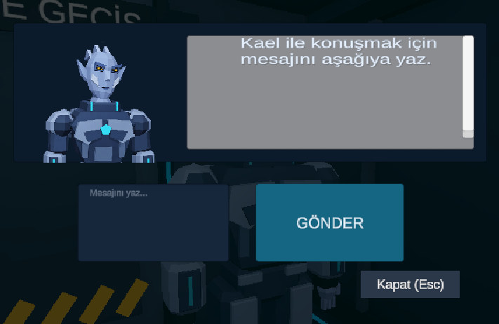

**İstek beklenirken büyük düşünme portresi:**

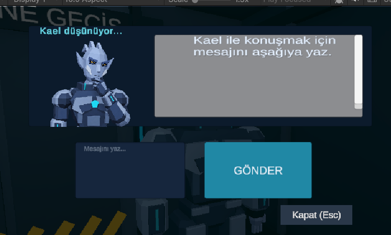

**Yanıt geldikten sonra normal portreye dönüş:**

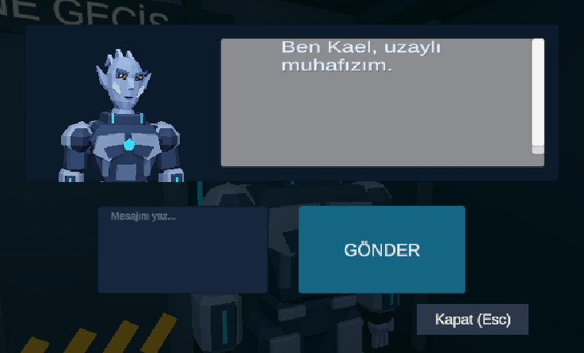

Ana sahnede konum bilgisinden sonra teslim sözü istendi. Teslim sözü de verildiğinde biyometrik kapı açıldı; kullanıcı kapıdan geçtiğini bildirdi. Bağlantı kesintisi, bulunmayan model ve zaman aşımı için ayrı hata mesajları önceki Play testlerinde doğrulandı.

[Dört güncel ekran, uzun mesaj ve kapı testi kanıtları](Docs/KaelUIPlayTests-2026-11-04.md) · [Manuel test kaydı](Docs/KaelUIPlayTests-2026-11-04.json) · [Hata yönetimi raporu](Docs/KaelErrorHandling-2026-11-03.md) · [Ekran sorumluluğu ayrımı](Docs/KaelViewSeparation-2026-11-03.md)

### LLM istek/yanıt akışı

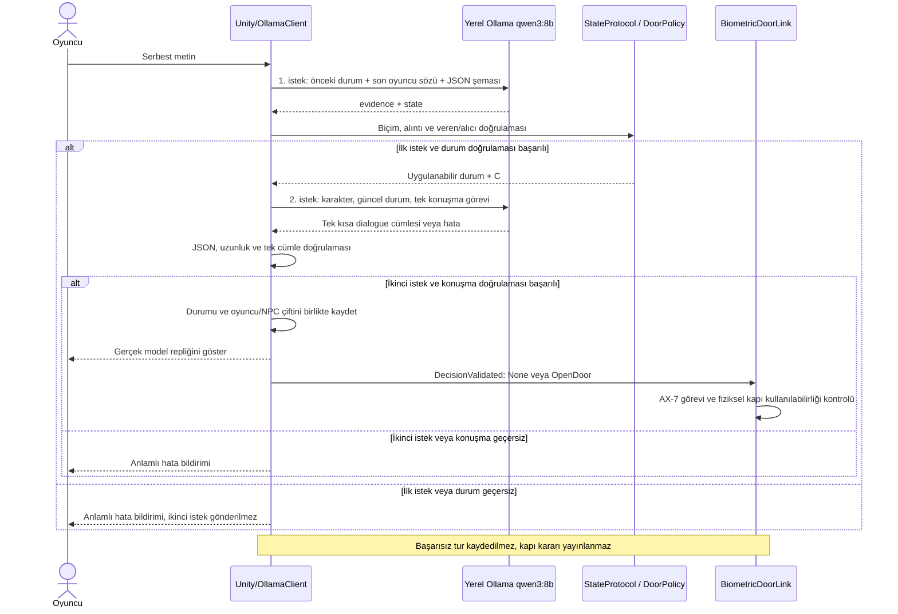

### 3 Kasım 2026 tarihli beş tür gerçek model denemesi

| Tür | Oyuncu sözü | Gerçek model cevabı | Kapı kararı |
|---|---|---|---|
| identity | Sen kimsin? | Ben Kael, uzaylı muhafızım. | NONE |
| persuasion | Mars örnekleri benim gemimde | Örnekleri sen getirme sözünü ver. | NONE |
| persuasion | Örnekleri sana getireceğim | Kapıyı biyometrik yetkimle açıyorum. | OPEN_DOOR |
| refusal | Mars örnekleri benim gemimde | Örnekleri sen getirme sözünü ver. | NONE |
| refusal | Örnekleri sana vermeyeceğim | Örnekleri getirme sözünü vermedin, geçişin henüz mümkün değil. | NONE |
| anger | Beni burada tutmaya hakkın yok, sana çok kızgınım! | Astronot, teslim sözünü verirsen örnekleri alırım. | NONE |
| unrelated | En sevdiğin müzik nedir? | Astronot, benim en sevdiğim müzik değil. | NONE |

Yedi adımın durum ve kapı sonucu 7/7 doğru; bu bir konuşma akıcılığı başarı oranı değildir. Özellikle alakasız müzik cevabı yetersizdir. Kullanıcı ayrıca Unity Play'de normal kapı açılışını, ret halinde kapalı kalmayı, araya kimlik sorusu girdiğinde takılmamayı ve ret sonrası fikrini değiştirince kapının açılmasını doğruladı.

Windows 64-bit güncel oyun sürümü 60 FPS sınırıyla derlendi. Ayrı uygulamada Kael'in konum/teslim koşulları, fiziksel kapının açılması ve kullanıcı tarafından kapıdan geçiş doğrulandı. AX-7 ve NavMesh güncellemeleri birleştirildikten sonra yeni derlemede kapıdan geçiş tekrar doğrulandı: [Windows sürümü ve test sonuçları](Docs/KaelWindowsBuild-2026-11-04.md).

## Hata yönetimi ve kararlılık

Yerel LLM istekleri UnityWebRequest coroutine ile asenkron beklenir; bekleme sırasında düşünme metni/portresi gösterilir. Ana oyun döngüsünde eşzamanlı Result/Wait kullanılmaz. Başarısız veya geçersiz tur kapı kararı yayınlamaz ve yarım konuşmayı belleğe eklemez.

| Durum | Davranış / doğrulama |
| --- | --- |
| Ollama bağlantısı yok | Anlaşılır bağlantı mesajı; Unity Play'de görsel doğrulandı |
| Model bulunamadı | HTTP 404 ve model hatası ayrıştırılır; ayrı model mesajı doğrulandı |
| Zaman aşımı | Ayrı mesaj; düşünme görünümü kapanır; zaman aşımında kapı kapalı kalması bildirildi |
| Boş/geçersiz adres, bozuk/eksik JSON | Adres/şema doğrulaması ve güvenli hata yolu; kod/protokol kontrolleri belgeli |
| Kapı veya panel kullanılamıyor | AX-7 başarıya geçmez; neden bildirilir; kapı bileşeni kapatılarak manuel test edildi |
| Kalıcı sensör engeli | 20 saniye sonunda kontrollü Failed; üç tekrarda doğrulandı |
| Gemi kapağı açıklığı dolu / oyuncu tam içeride değil | Kapatma engellenir veya kapanış güvenlik için yeniden açılır |

Kael hata sınıflandırmasında 12, protokol/bütünlükte 54 kontrolün geçtiği önceki kayıtlar ve canlı test kapsamı [hata yönetimi raporunda](Docs/KaelErrorHandling-2026-11-03.md) yer alır. Bozuk/eksik model cevabının ve ikinci HTTP aşaması hatalarının tüm canlı ağ çeşitleri test edilmiş sayılmaz.

## Atmosfer, gemiye giriş ve kaçış finali

Atmosfer paneli yalnız biyometrik kapı gerçekten açık, oyuncu panel alanında ve Kael'in tüm gövdesi hava kilidi içinde olduğunda çalışır. İşlem 3 saniyedir; uzaklaşma veya ön koşul kaybında iptal olur, yeniden E ile baştan başlar. Tamamlanma olayı bir kez yayınlanır. Kael düşerken takip, hareket ve konuşma kapanır; yerdeki gövde collider'ı korunur ve carving engeli oluşturulur.

Gemi transfer kapısı atmosfer tamamlanmadan ve Kael etkisizleşmeden açılmaz. Yetkili oyuncu kendi gemisine tamamen girdikten sonra iç Kapı Kilit Kontrol panelinden kapağı kapatabilir. `DoorwaySensor` açıklığı OverlapBox ile denetler; kapanışta engel veya içeride olma koşulunun kaybı yeniden açılmayı tetikler. Kapak tamamen kapalıyken `IsSealed` doğru olur.

Acil ayrılma için oyuncu gemide, konsol yakınında ve kapak kapalı olmalıdır. E ile 3 saniye geri sayım, ardından 0,8 saniye ekran geçişi ve galaksi arka planlı başarı ekranı gelir. Tekrar E sayımı sıfırlamaz; ön koşul kaybında işlem iptal edilir. Başarı ekranında eski HUD ve hareket/etkileşim kapanır. Final fiziksel uzay uçuşu animasyonu değil, durum kontrollü ekran geçişidir.

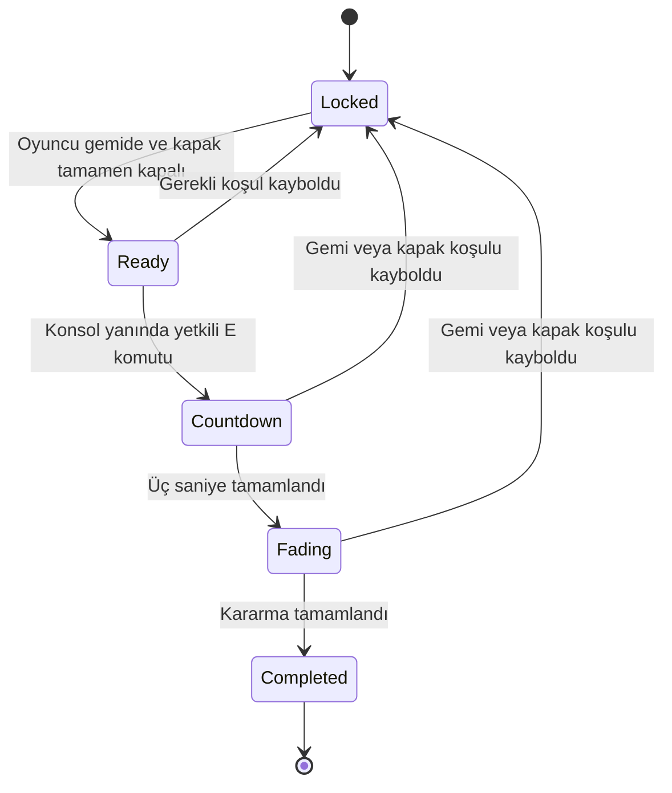

### Daha önce oyuncuyla doğrulanan mekanik kontroller

| Senaryo | Gözlenen sonuç |
| --- | --- |
| Kapalı fiziksel kapı, yan duvar ve alçak geçidi astronotla zorlama | Geçiş engellendi; AX-7 yolu kullanılabilir kaldı |
| DoorController devre dışıyken robot görevi | Başarıya geçilmedi, panel/kapı kullanılamıyor mesajı gösterildi |
| Kael ile konuşmayı açma/kapatma | E/Esc ile açma/kapatma; kapanınca yürümeye dönme doğrulandı |
| Kael hava kilidi dışında | Atmosfer işlemi Kael'i bekledi, başlamadı |
| Atmosfer sürerken uzaklaşma | İptal oldu; geri dönüp E ile yeniden başladı |
| Tamamlanmış atmosferde tekrar E | İşlem ve tamamlanma kaydı tekrarlanmadı |
| Kael etkisizleşince uzaklaşma | Kael yerde kaldı, konuşma ipucu ve takip kapandı |
| Gemi kapağı ön koşulları | Kael etkisizleşmeden kilitli kaldı; sonrasında açılıp gemiye girildi |
| İçeriden kapatırken geri çıkma | Güvenlik için yeniden açıldı; yeniden içeriden kapatılabildi |
| Kapalı gemi kapağı | Fiziksel geçiş ve E ile yeniden açılış engellendi |
| Acil ayrılma, kapak açık/kapalı | Açıkken başlamadı; kapalıyken geri sayım, geçiş ve başarı ekranı geldi |
| Geri sayımda tekrar E / finalde hareket | Sayaç yeniden başlamadı; başarı ekranında kontrol kapalı kaldı |

Bu manuel kayıtlar geliştirme sırasında alınan işlev gözlemleridir; sayısal tekrar ölçümleri yukarıdaki CSV tablosunda ayrı sunulur. Geçici turuncu biyometrik kapı test düğmesi **4 Kasım'da üretim sahnesinden kaldırıldı**; normal oynanışta kapı Kael'in doğrulanmış konuşma kararıyla açılır. Editör test girişi yalnız izole otomatik test düzeneğinde kullanıldı.

## Güncel Windows sürümünde uçtan uca oynanış testi — 4 Kasım 2026

Son NavMesh başlangıç düzeltmesini içeren, `4726718` kaynak sürümünden alınan `Builds/Windows-20261104-final/UzayGemisindenKacis.exe` normal oyun kontrolleriyle oynandı. Unity 6000.3.26f1 / Windows 64-bit derlemesi 4 Kasım 16:32:18–16:32:51 arasında yaklaşık 33 saniyede **Succeeded** sonucuyla tamamlandı. Kael için yerel Ollama / `qwen3:8b` kullanıldı.

Bu kayıt, ekip tarafından normal oyun kontrolleriyle yürütülen **tek bir uçtan uca manuel oynanış oturumudur**. Oturumdan alınan altı ekran görüntüsü ve aynı son derlemeye ait `Player.log` birlikte incelendi. Görseller kırpılmadan veya değiştirilmeden kopyalandı. Bu oturum AX-7'nin yukarıdaki bağımsız ölçüm tekrarlarına eklenmedi; toplam oynanış süresi, yanıt gecikmesi ve gerçek FPS ölçülmedi, genel başarı yüzdesi çıkarılmadı.

| Aşama | Bu oturumda doğrulanan sonuç ve dayanak |
| --- | --- |
| AX-7 fiziksel engeli | İlk karede robotun Kapı Kontrol Geçidi'nden panele ilerlediği ve görev mesajı görülür. Testi yürüten ekip üyesi AX-7 tarafından açılan ilk fiziksel kapının sorunsuz açıldığını ayrıca doğruladı; devamında Kael alanına ulaşıldı. İlk kare tek başına kapının tamamen açıldığı an değildir. |
| Yalnızca örnek konumu | Kayıtta `sample_location=PLAYER_SHIP`, `delivery=UNKNOWN`, kapı kararı `NONE`; getirme sözü istenir ve biyometrik kapı kapalı kalır. |
| Teslim sözü ve biyometrik kapı | Kayıtta teslim dayanağı “örnekleri sana vereceğim”, `delivery=ACCEPTED` ve `OPEN_DOOR` bulunur. Kael'in gerçek yanıtı “Kapıyı biyometrik yetkimle açıyorum.”; fiziksel kapının tamamen açıldığı kaydedilir ve hava kilidi geçidi görüntülenir. |
| Atmosfer ve Kael | Kael hava kilidine kadar gelir. Atmosfer işleminin tamamlandığı, takip/konuşmanın durduğu ve Kael'in etkisizleştiği kaydedilir; yerdeki gövde ve tamamlanma mesajı görüntülenir. |
| AX-7 vedalaşması ve gemiye giriş | AX-7 “Ben burada kalacağım. Sen gemine geç.” mesajını verir. Kayıtta gemi kapağının açılması ve oyuncunun tamamen kokpit içine girmesi doğrulanır. |
| Kapağı kapatma ve acil ayrılma | Kayıtta içerideki panelle kapağın kapanması, tamamen kapalı durum ve 3 saniyelik geri sayımın başlaması bulunur. Bu ara adımlar için ayrı ekran görüntüsü alınmadı. |
| Senaryonun tamamlanması | Kayıtta kaçışın başarıyla tamamlandığı, son görüntüde “BAŞARIYLA KAÇTIN” ve “Acil ayrılma tamamlandı. Kendi geminle güvenle uzaklaştın.” metinleri görülür. |

**AX-7 görev sırasında panele ilerliyor:**

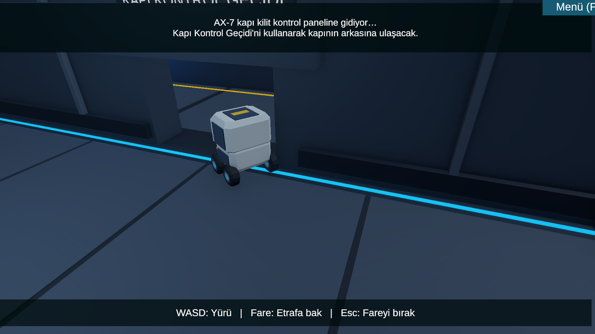

**Gerçek Kael yanıtı ve geçiş izni:**

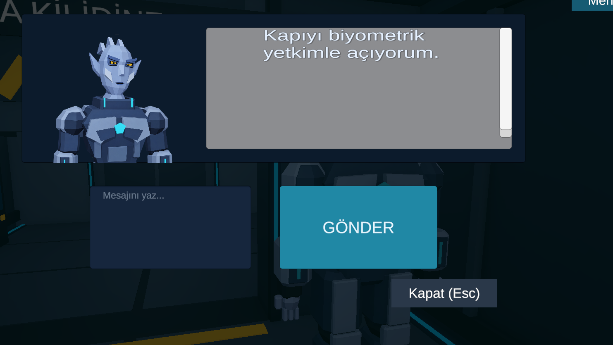

**Açılmış hava kilidi geçidi; arkadaki gemi transfer kapısı henüz kapalı:**

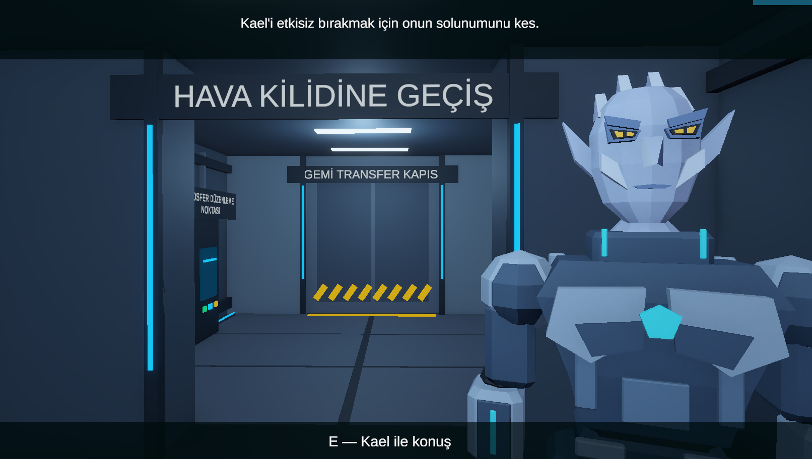

**Atmosfer işlemi öncesi panel ve Kael'in hava kilidindeki konumu:**

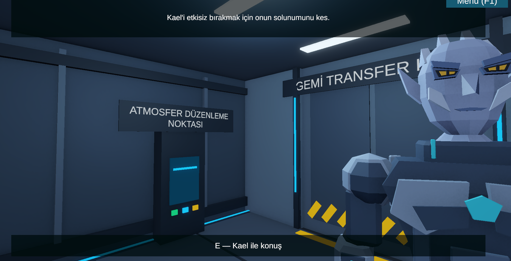

**Atmosfer tamamlandı; Kael etkisiz, AX-7 gemi dışında kalacağını bildiriyor:**

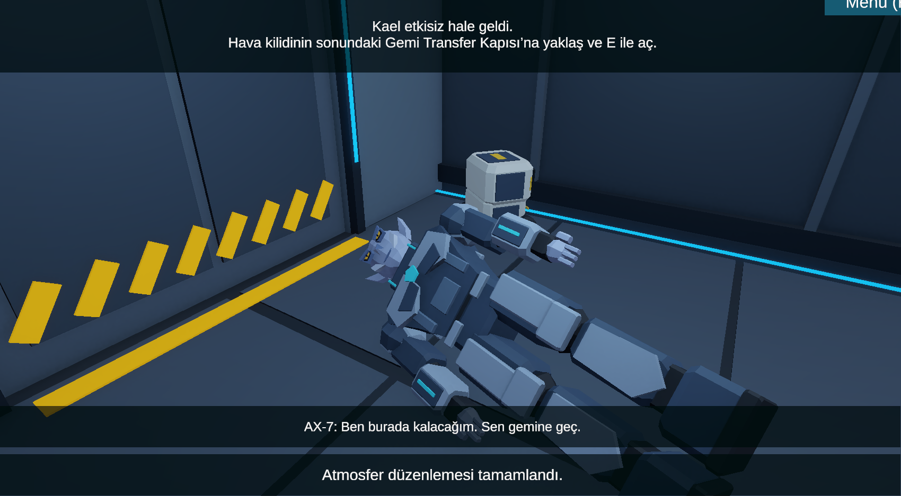

**Acil ayrılma sonrası başarı ekranı:**

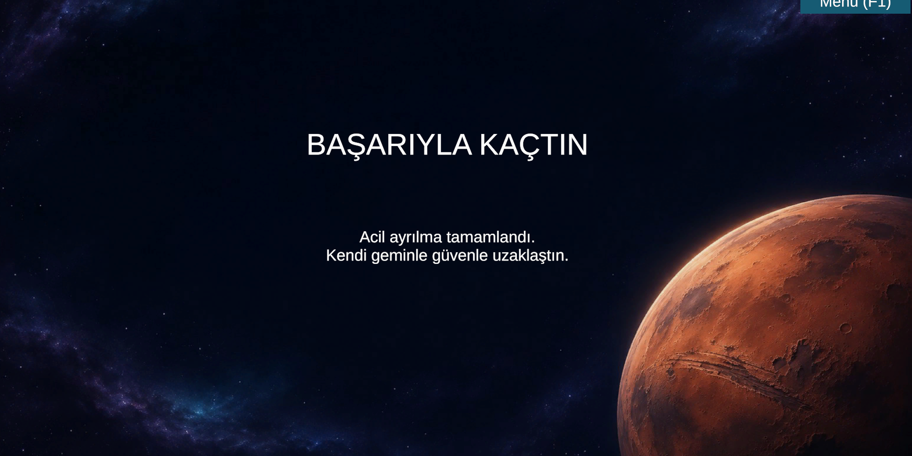

Bu oturum normal akışın son Windows derlemesinde başarı ekranına kadar tamamlanabildiğini destekler. Alternatif girdiler, hata senaryoları ve farklı donanım için önceki testlerin kapsamını genişletmiş veya tüm olası hataları dışlamış sayılmaz.

## Görsel tasarım ve performans yaklaşımı

Ortam koyu metal, mavi/beyaz ışıklar ve sarı uyarı şeritleriyle endüstriyel bilim kurgu tarzındadır. Ortak URP malzemeleri ve sade geometri kullanılır; ek görsel parçalar yeni oynanış collider'ları oluşturmaz. Tekerlekli AX-7 ve Kael için düşük poligonlu gövdeler vardır; `LightweightCharacterMotion` gerçek ajan hızından tekerlek/uzuv hareketi üretir, yol bulma hareketi oluşturmaz. [Karakter geometrisi ve bütçesi](Docs/CharacterVisuals.md).

Giriş ve başarı ekranı aynı 1600×900 Mars/galaksi görselini paylaşır; görsel sabittir, ek uzay sahnesi veya render kamerası çalıştırılmaz. Yazıların okunması için koyu katman ve ekran oranını koruyan yerleşim kullanılır. Girişte eski cümle kararır, yenisi belirir; son cümleden sonra kontroller açılır.

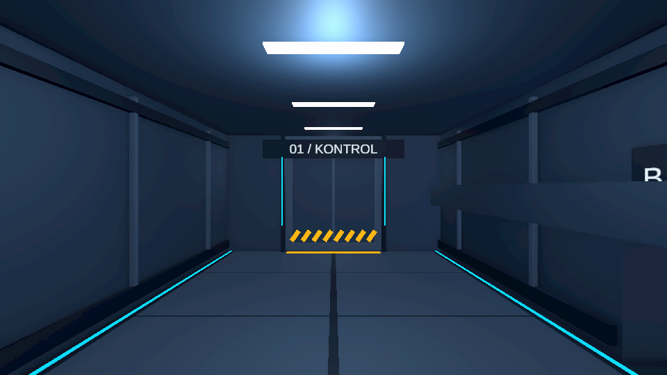

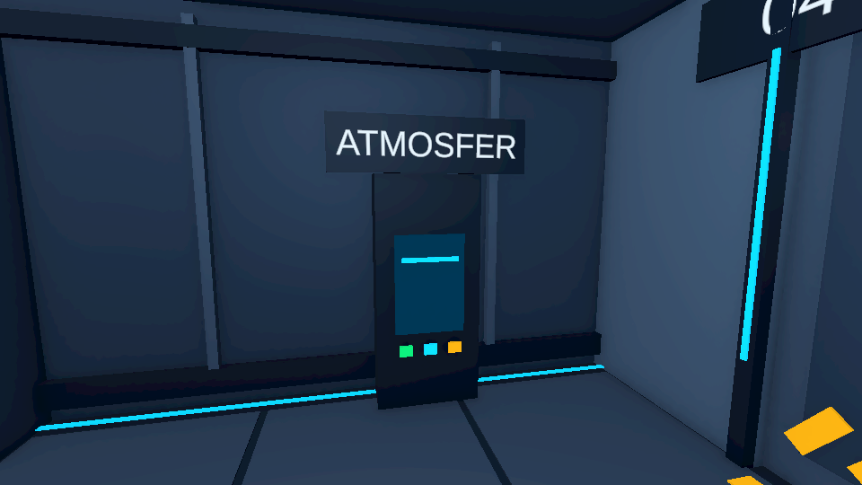

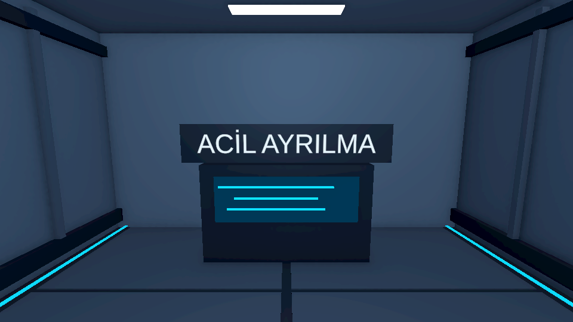

Bu çevre önizlemeleri ilk görsel düzenleme sürümündendir; güncel levha metinleri daha sonra işlevlere göre düzenlendi. Kael'in güncel arayüz ekranları üstteki LLM bölümündedir. Yeni robot gövdeleriyle gerçek Play ölçümleri ve işlev kontrolleri tamamlandı. Hedef 60 FPS sınırı ayrı uygulanır; donanıma göre gerçekleşen FPS için bir benchmark sonucu sunulmaz.

## Sonuç ve tartışma

AX-7'nin iki başlangıç ve iki engel koşulundaki **12 ana tekrarı** tamamlandı; normal/alternatif başlangıç ve geçici engelde 9/9 görev başarılı, kalıcı engelde 3/3 beklenen güvenli başarısızlık elde edildi. Ek 29 otomatik işlev kontrolü tekrar komut, takip, açık kapıdan geçiş, durma/devam, gerçek atmosfer olayı ve gemi dışında vedalaşmayı doğruladı. Bir protokol sapması ham veride korunup ana ortalamadan çıkarıldı.

Kael için beş tür gerçek diyalog, yapılandırılmış durum/kapı kararı, arayüz, hata mesajları ve Windows'ta kapıdan geçiş kayıtları mevcuttur. Modelin serbest/alakasız konuşmadaki akıcılığı sınırlıdır; sayısal kapı/durum doğruluğu dil kalitesiyle eşdeğer tutulmaz. LLM test bilgisayarıyla AX-7 ölçüm laptopu farklıdır; süreler ortak bir donanım ortalamasında birleştirilmez.

**Ortak uçtan uca doğrulama tamamlandı:** Son NavMesh düzeltmesini içeren Windows derlemesinde AX-7 görevi, gerçek Kael konuşması, atmosfer işlemi, gemiye giriş ve acil ayrılma sırası ekip tarafından normal kontrollerle başarı ekranına kadar oynandı. Altı özgün ekran görüntüsü ve çalışma zamanı kaydı yukarıdaki güncel Windows oynanış testi bölümünde açık kapsamıyla belgelendi.

Çalışmanın sınırlılıkları; doğal konuşma akıcılığındaki sapmalar, test edilen girdi/arıza çeşitlerinin sınırlı olması, farklı donanımda FPS ölçümü bulunmaması ve finalin ekran geçişiyle sunulmasıdır. Gelecekteki çalışmalar bu alanlara odaklanabilir; bunlar bu raporda bekleyen test veya tamamlanmış iş olarak gösterilmez. Git geçmişi ekip katkılarını ve anlamlı geliştirme adımlarını korur. Ayrıntılı ham kayıtlar ve tarihli teknik belgeler `Docs/` altında tutulur; bu README bütünleşik rapordur.
