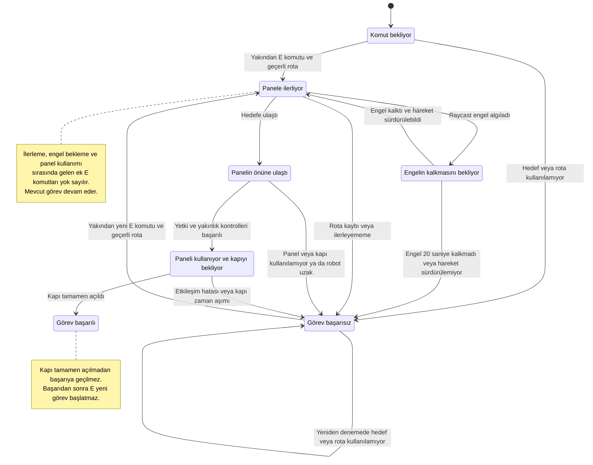

# Uzay Gemisinden Kaçış Oyunu

## Ekip Üyeleri

- Eminenur Kazan
- Zülal Şahin

**Rapor güncelleme tarihi:** 19 Ekim 2026

## Proje Hakkında

Astronotun gemisi, navigasyon arızası nedeniyle bir uzaylı gemisine yanlışlıkla kenetlenir. Oyuncunun amacı kendi gemisine dönerek kaçmaktır. Mars örnekleri astronotun kendi gemisindedir.

Oyunda birbirinden ayrı iki yapay zekâ bileşeni planlanmıştır:

1. **AX-7:** Oyuncudan emir alan, bakım yolunu NavMesh ile kullanarak kontrol paneline ulaşan ve fiziksel kapıyı açan otonom yardımcı robot.
2. **Kael:** Oyuncuyla serbest metin üzerinden konuşan ve yerel Ollama modelinin yapılandırılmış yanıtıyla biyometrik geçiş kararını veren güvenlik görevlisi.

Bu raporda AX-7'nin uygulanan fiziksel kapı görevi, bileşenleri ve manuel testleri belgelenmiştir. Kael'in geliştirilmekte olan diyalog denemesi `AITestScene` sahnesindedir; ana oyun sahnesine entegrasyonu ve ayrıntılı LLM raporu henüz tamamlanmamıştır.

## Kullanılan Teknolojiler

- Unity **6000.3.26f1**, Universal Render Pipeline (URP)
- C# ve Unity Input System
- AI Navigation / NavMesh
- Physics Raycast
- TextMesh Pro
- Kael için yerel Ollama entegrasyonu
- Git ve GitHub

## Mevcut Proje Durumu

`Assets/Scenes/EscapeScene.unity` içinde giriş koridoru, kilitli fiziksel kapı, alçak bakım yolu, kontrol paneli, astronot ve AX-7 bulunmaktadır. Astronotun hareketi, kamerası ve çarpışması çalışmaktadır. AX-7 komutla bakım yolundan panele gitmekte, paneli kullanmakta ve kapıyı açmaktadır.

Ana sahnede panel alanının devamına Kael güvenlik alanı, geçici Kael kapsülü ve kapalı biyometrik kapı taslağı eklenmiştir. Astronotun bu alana ulaşması manuel olarak doğrulanmıştır. Kael diyalogu henüz bu kapsüle bağlanmamıştır. Hava kilidinin taslağı henüz oluşturulmamıştır. Mevcut blok modeller oynanış prototipidir; uzay gemisi görünümüne yönelik görsel çalışma daha sonra yapılacaktır.

## AX-7 Görevini Çalıştırma

1. Projeyi Unity **6000.3.26f1** ile açın ve derlemenin tamamlanmasını bekleyin.
2. `Assets/Scenes/EscapeScene.unity` sahnesini açın. Normal görev testi için `SensorTestEngeli` nesnesi kapalı olmalıdır.
3. Play'e basın ve Game alanına tıklayın.
4. AX-7'ye yaklaşarak ekrandaki E komutunu kullanın.
5. Robotun bakım yolunu kullanmasını, paneli etkinleştirmesini ve kapının açılmasını bekleyin.
6. Kapı açıldıktan sonra astronotla geçiş yapın.

| Kontrol | İşlev |
|---|---|
| WASD | Astronotu hareket ettirme |
| Fare | Etrafa bakma |
| E | Yakındaki AX-7'ye kontrol paneline gitme komutu verme |
| Esc | Fareyi serbest bırakma |
| Game alanına tıklama | Oyun kontrolünü geri alma |

Komut mesafesi yatay düzlemde **3 birimdir**. E yalnızca robot `Waiting` veya `Failed` durumundayken, robotun bileşeni etkinken ve oyuncu yeterince yakınken kabul edilir. Pencere odağı kaybolmuşsa veya fare serbestse E komutu gönderilmez.

**Görev sürerken E'ye tekrar basılması yok sayılır: görev yeniden başlamaz ve bu nedenle başarısız olmaz.** Başarılı görev de E ile tekrar başlatılmaz. Başarısızlık sonrasında yeni komut verilebilir; geçerli rota hâlâ bulunamıyorsa robot başarısız durumda kalır.

## AX-7 Bileşenleri ve OOP Tasarımı

Kaynak dosyalar `Assets/Scripts/` altındadır.

| Bileşen / arayüz | Sorumluluk |
|---|---|
| `CompanionCommandInput` | Tuşu, komut mesafesini ve komut verilebilecek durumu kontrol eder. |
| `CompanionHUD` | Görev açıklamasını, E ipucunu ve robotun durumunu ekranda gösterir. |
| `AX7Brain` | Durum makinesini yönetir ve diğer bileşenlerden gelen bilgilere göre karar verir. |
| `INavigationMotor` | Hedefe gitme, durum sorgulama, duraklatma, sürdürme ve durma sözleşmesini tanımlar. |
| `NavMeshMovement` | Bu hareket arayüzünü gerçek `NavMeshAgent` yol bulmasıyla uygular. |
| `IObstacleSensor` | Engel gözlemi için kullanılan arayüzdür. |
| `ObstacleSensor` | Raycast ile engeli, mesafesini ve açısını ölçer. |
| `IInteractable` | Robotun etkileşim isteği ve etkileşim sonucunu sorgulaması için ortak sözleşmedir. |
| `ControlPanel` | Yetkili robotu ve yakınlığı kontrol eder, panel kullanımını ve kapının açılmasını izler. |
| `IOpenableDoor` | Kapının açılabilmesi, kullanılabilirliği ve açık durumunu bildirmesi için sözleşmedir. |
| `DoorController` | Kapının yukarı kayarak açılmasını ve tamamen açık durumunu yönetir. |

`IObstacleSensor`, `ObstacleSensor.cs`; `IOpenableDoor`, `IInteractable.cs` içinde tanımlıdır. Robotun görsel gövdesi, `AX-7` kökü altındaki `AX7Govde` nesnesindedir.

Karar, hareket, algılama, etkileşim ve ekran gösterimi ayrı sorumluluklardır. `AX7Brain`, hareket/sensör/panel işlemlerini arayüzleri üzerinden kullanır; panel de kapıyı `IOpenableDoor` üzerinden açar. Somut Unity bileşenleri Inspector alanlarıyla bağlanır. Durum ve hata bilgileri dışarıya salt okunur özelliklerle sunulur.

Bu ayrım AX-7 için uygulanan OOP yaklaşımıdır. Kael dahil uygulamanın tamamının mimari incelemesi ve düzenlemesi henüz tamamlanmış kabul edilmemektedir.

## AX-7 Durum Makinesi

Diyagram, bağlantıları doğru kurulmuş oyunun görev akışını gösterir. Başlangıçta gerekli bileşenlerden biri bağlı değilse robot hata bildirip karar bileşenini devre dışı bırakır; bağlantı düzeltilmeden E ile yeniden deneme yapılamaz. Play'in durdurulmasıyla çalışma zamanı test değişiklikleri geri alınır.

## Gerçek Yol Bulma ve Raycast Algısı

`AX7NavigationSetup` yalnızca editörde NavMesh hazırlamak ve rota bağlantısını kontrol etmek için kullanılan araçtır. Üst menüdeki **Uzay Oyunu > AX-7 NavMesh Hazırla** komutuyla çalıştırılır. Hazırlık sırasında karakter gövdeleri sabit çevre engeli olarak hesaba katılmaz. Kayıtlı NavMesh verisi `Assets/Navigation/AX7NavMesh.asset` dosyasındadır. Hesaplama hacmi Z ekseninde -15 ile +15 arasını kapsar. Kael alanı sahnede mevcutsa hazırlık aracı, panelden bu alandaki iki kontrol noktasına kesintisiz rota bulunmasını da doğrular. Bu editör kontrolü, AX-7’nin Kael alanına fiilen yürütüldüğü bir test değildir. Geometri değişikliğinden sonra yalnızca Reload yeterli değildir; NavMesh hazırlama menüsü yeniden çalıştırılmalıdır.

Oyun sırasında `NavMeshMovement`, hedefe tam rota bulunmasını kontrol eder ve `NavMeshAgent` ile hareket eder. Hazırlık aracındaki sabit kontrol noktaları doğrulama içindir; robot bu noktalarda önceden yazılmış hareketlerle yürütülmez.

Sensör, robotun orta yüksekliğinden yolun bir sonraki dönüş noktasına doğru üç paralel Raycast gönderir. Algılama uzaklığı bir sonraki dönüş noktasını aşmaz; böylece köşe arkasındaki duvarın gereksiz yere engel sayılması azaltılır. Robotun kendi gövdesi ve tetikleyici collider'lar dışlanır. En yakın algılanan engelin mesafesi, açısı ve adı sensör bileşeninde tutulur.

Engel algılanınca `AX7Brain`, hareket arayüzünden duraklama ister. `NavMeshAgent.isStopped` kullanılır; rota silinmez. Engel kalkınca hareket sürdürülür. Sensörün tespit ettiği engelin etrafından yeni rota arama bu aşamada uygulanmamıştır; davranış bekleme, devam etme veya zaman aşımıyla başarısızlık bildirmedir.

| Ayar | Mevcut değer |
|---|---:|
| AX-7 NavMesh ajan yüksekliği | 0,8 birim |
| AX-7 NavMesh ajan yarıçapı | 0,35 birim |
| Bakım geçidi iç yüksekliği | 1,2 birim |
| Astronot yüksekliği | 2 birim |
| Raycast üst algılama mesafesi | 0,9 birim |
| Işın başlangıç yüksekliği | 0,4 birim |
| Yan ışınların merkezden uzaklığı | 0,24 birim |
| Engel bekleme süresi sınırı | 20 saniye |
| Hareket sırasında ilerleyememe sınırı | 6 saniye |
| Hareket süresi sınırı | 45 saniye; sensör nedeniyle duraklama hariç |
| Panelin yatay etkileşim mesafesi | 1,2 birim |
| Panel etkinleştirme süresi | 1 saniye |
| Kapının tamamen açılmasını bekleme sınırı | 8 saniye |

## Panel ve Kapı Etkileşimi

Panele varıştan sonra robotun `Transform` kimliği paneldeki yetkili AX-7 ile karşılaştırılır. Robot yeterince yakınsa panel kullanımına başlanır. Etkinleştirmeden önce robot uzaklaşırsa veya panel/kapı kullanılamazsa etkileşim başarısız olur.

Panel kullanım süresi dolunca kapıya açılma isteği gönderilir. Kapı, çarpışma bileşeniyle birlikte **3,2 birim yukarı** hareket eder. Robot ancak kapı tamamen açık durumunu bildirdiğinde `Succeeded` durumuna geçer. Başarı mesajından sonra astronot fiziksel açıklıktan geçebilir.

## Manuel Testler ve Gözlenen Sonuçlar

Aşağıdaki kayıtlar Unity editöründe birlikte yürütülen ve oyuncu tarafından doğrulanan manuel denemelerdir. Tamamlanma süreleri kronometre veya otomatik kayıtla ölçülmemiştir. Tekrar sayıları sistematik olarak tutulmadığından istatistiksel başarı oranı veya ortalama süre hesaplanmamıştır.

| No | Senaryo | Gözlenen sonuç |
|---|---|---|
| T01 | Varsayılan robot başlangıcı: X=1,5; Z=-12. E komutuyla fiziksel kapı görevi. | AX-7 bakım yoluyla panele ulaştı, paneli kullandı ve kapıyı açtı. Astronot açılan kapıdan geçti. |
| T02 | Doğrulanan alternatif başlangıç: **X=0; Y=0,02500004; Z=-10**. | E komutuyla görev başarıyla tamamlandı. |
| T03 | `SensorTestEngeli` etkin; robot durduktan sonra engel 20 saniye dolmadan kaldırıldı. | Engel algılandı, robot bekledi; engel kalkınca yeni komut olmadan devam edip panel önüne ulaştı. Bu deneme kapı entegrasyonundan önceki sensör aşamasında yapıldı. |
| T04 | Test engeli, robot durduktan sonra 20 saniyeden uzun süre etkin bırakıldı. | Görev başarısız oldu; engelin uzun süre kalkmadığını belirten mesaj gösterildi. |
| T05 | Play sırasında `FizikselKapi` üzerindeki yalnızca `DoorController` devre dışı bırakıldı; collider açık kaldı. | Robot panelde başarıya geçmedi. Görevin tamamlanamadığı ve panelin veya bağlı kapının kullanılamadığı bildirildi. |
| T06 | Astronotla kapalı fiziksel kapı, yan duvarlar ve alçak bakım girişi zorlandı. | Geçiş engellendi. Bakım yolu robot için kullanılabilir kaldı. |
| T07 | Fiziksel kapı açıldıktan sonra astronotla yeni güvenlik alanına ilerleme. | Oyuncu Kael kapsülünün yanına ulaşabildi. |
| T08 | Kael alanını kapsayacak şekilde genişletilen NavMesh’in editörde yeniden hazırlanması. | Panelden Kael alanına kesintisiz rota doğrulandı; mavi NavMesh gösterimi alana yayıldı. Bu sonuç fiziksel robot takip testi değildir. |

Başlangıç koordinatları canlı `NavMeshAgent` tarafından değiştirilmiş olan önceki deneme, doğrulanmış alternatif başlangıç sonucu olarak sayılmamıştır. Başarılı varış konumu, başlangıç konumu yerine kullanılmamıştır.

### Testleri Tekrarlama

- Her bağımsız deneme için Play'i durdurup yeniden başlatın.
- Alternatif başlangıç için **yalnızca Play sırasında** AX-7'nin `NavMeshAgent` bileşenini kapatın, kök nesnenin Position değerlerini ayarlayın ve bileşeni yeniden açın. E'ye basmadan X/Z değerlerinin korunduğunu kontrol edin. Y'nin yaklaşık 0,025'e düzeltilmesi kabul edilir.
- Sensör testi için Play sırasında `SensorTestEngeli` nesnesini etkinleştirin. Normal görev denemesinde bu nesne kapalı kalmalıdır.
- Kapı arızası testi için kapı nesnesini veya collider'ını değil, yalnızca `DoorController` bileşenini Play sırasında kapatın.
- Test amaçlı konum ve etkinlik değişikliklerini sahneye kalıcı olarak kaydetmeyin.

### Tamamlanacak Test ve Ölçümler

- Her başlangıç konumu/engel koşulu için önceden belirlenmiş tekrar sayısıyla görev süresini ve sonuçlarını kaydetme.
- Bu kayıtlardan senaryo bazında başarı oranı ve başarılı görevlerin ortalama tamamlanma süresini hesaplama.
- Geçici ve kalıcı engel senaryolarını panel–kapı entegrasyonlu son sürümde tekrar çalıştırma.
- E komutunun mesafe, odak ve tekrar basma sınırlarını ayrı test kayıtlarıyla belgeleme.
- Rota bulunamaması, panelden uzaklaşma ve kapının açılma zaman aşımı dallarını ayrı ayrı deneme.
- Test ekran görüntülerini rapora ekleme.

## Sınırlılıklar ve Sonraki Çalışmalar

- Bakım yolunun tavanı hareketi izleyebilmek için görünmezdir; collider'ı etkindir. Yeniden göstermek için `BakimYoluTavan` nesnesinin Mesh Renderer bileşeni açılır.
- AX-7'nin görev sonrasında oyuncuya dönmesi ve takip etmesi henüz uygulanmamıştır.
- Panelden Kael alanına NavMesh bağlantısı editörde doğrulanmıştır; AX-7’nin görev sonrası oyuncuyu takip ederek bu alana yürümesi henüz uygulanmamış ve test edilmemiştir.
- Kael alanı ve kapalı biyometrik kapının blok taslağı hazırdır. Kael diyalogunun ana sahneye bağlanması, biyometrik kapının karar sonucu açılması, hava kilidi ve kaçış sonu tamamlanacaktır.
- Kael'in yerel model seçiminin gerekçesi, sistem promptu, istek/yanıt sequence diyagramı, hata yönetimi ve en az beş gerçek model diyalog testi ayrıca belgelenecektir.
- Uygulamanın tamamının OOP incelemesi, görsel düzenlemeler ve teslim build'i henüz tamamlanmamıştır.

Anlamlı geliştirme adımları Türkçe commit mesajlarıyla ortak GitHub deposuna gönderilmektedir.
