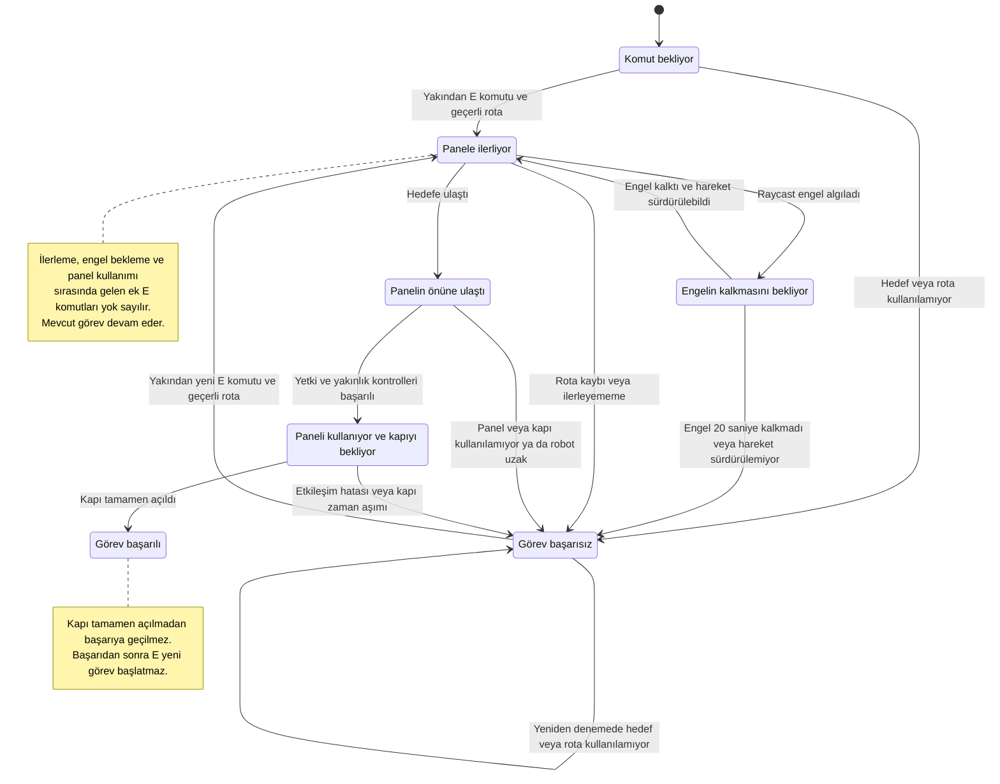
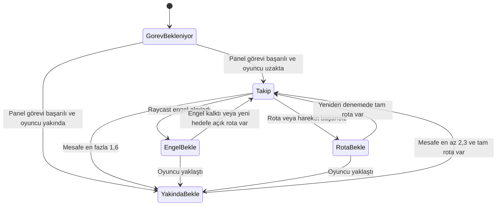
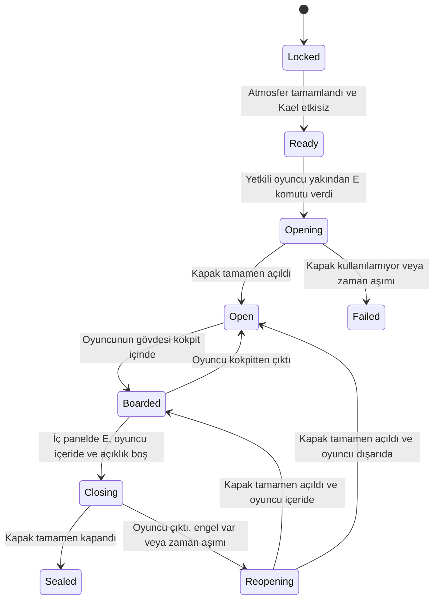
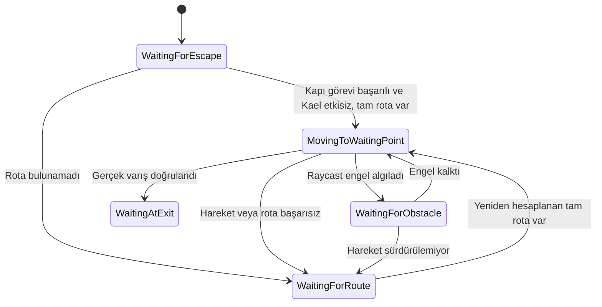
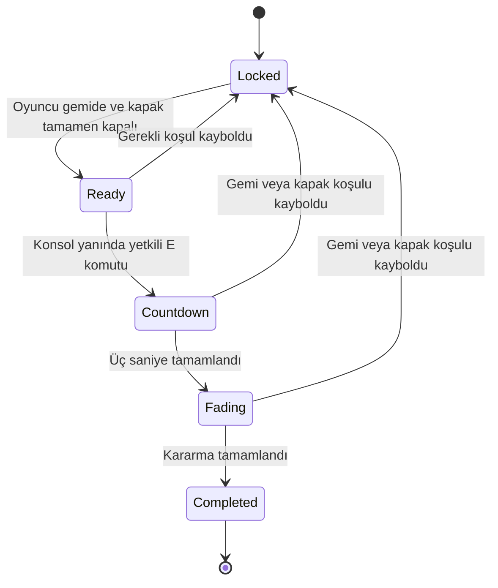

# Uzay Gemisinden Kaçış Oyunu

## Ekip Üyeleri

- Eminenur Kazan
- Zülal Şahin

**Rapor güncelleme tarihi:** 28 Ekim 2026

## Proje Hakkında

Astronotun gemisi, navigasyon arızası nedeniyle bir uzaylı gemisine yanlışlıkla kenetlenir. Oyuncunun amacı kendi gemisine dönerek kaçmaktır. Mars örnekleri astronotun kendi gemisindedir.

Oyunda birbirinden ayrı iki yapay zekâ bileşeni planlanmıştır:

1. **AX-7:** Oyuncudan emir alan, bakım yolunu NavMesh ile kullanarak kontrol paneline ulaşan ve fiziksel kapıyı açan otonom yardımcı robot.
2. **Kael:** Oyuncuyla serbest metin üzerinden konuşan ve yerel Ollama modelinin yapılandırılmış yanıtıyla biyometrik geçiş kararını veren güvenlik görevlisi.

Bu raporda AX-7'nin fiziksel kapı ve takip görevleri, ana sahneye bağlanan Kael konuşması ve manuel testler belgelenmiştir. `AITestScene` bağımsız diyalog denemeleri için korunmuştur. Kael'in ayrıntılı LLM raporu henüz tamamlanmamıştır.

## Kullanılan Teknolojiler

- Unity **6000.3.26f1**, Universal Render Pipeline (URP)
- C# ve Unity Input System
- AI Navigation / NavMesh
- Physics Raycast
- TextMesh Pro
- Kael için yerel Ollama entegrasyonu
- Git ve GitHub

## Mevcut Proje Durumu

`Assets/Scenes/EscapeScene.unity` içinde giriş koridoru, kilitli fiziksel kapı, alçak bakım yolu, kontrol paneli, astronot ve AX-7 bulunmaktadır. Astronotun hareketi, kamerası ve çarpışması çalışmaktadır. AX-7 komutla bakım yolundan panele gitmekte, paneli kullanmakta ve kapıyı açmaktadır.

Ana sahnede panel alanının devamına Kael güvenlik alanı, geçici Kael kapsülü ve kapalı biyometrik kapı taslağı eklenmiştir. Astronotun bu alana ulaşması manuel olarak doğrulanmıştır. Kael konuşması bu kapsüle bağlandı; gerçek model kararıyla biyometrik kapının açıldığı doğrulandı. Konuşma kuralına uyum sapması ayrıca kaydedildi. Biyometrik kapının arkasında `HavaKilidi` grubu altında yan duvarlar, atmosfer kontrol paneli ve gemiye geçiş kapağının blok taslağı da oluşturulmuştur. Atmosfer panelinin E etkileşimi, süreli tamamlanması, uzaklaşınca iptali ve tek seferlik tamamlanma kaydı oyuncuyla test edildi. Gemiye geçiş kapağı için atmosfer/Kael ön koşullu E etkileşimi ve aynı sahnede küçük kokpit eklendi; oyuncu giriş testini doğruladı. Kapağı içeriden kapatma oyuncuyla doğrulandı. Geri sayımlı acil ayrılma ve başarı ekranı oyuncuyla Play modunda doğrulandı. Mevcut blok modeller oynanış prototipidir; uzay gemisi görünümüne yönelik görsel çalışma daha sonra yapılacaktır.

## AX-7 Görevini Çalıştırma

1. Projeyi Unity **6000.3.26f1** ile açın ve derlemenin tamamlanmasını bekleyin.
2. `Assets/Scenes/EscapeScene.unity` sahnesini açın. Normal görev testi için `SensorTestEngeli` nesnesi kapalı olmalıdır.
3. Play'e basın ve Game alanına tıklayın.
4. AX-7'ye yaklaşarak ekrandaki E komutunu kullanın.
5. Robotun bakım yolunu kullanmasını, paneli etkinleştirmesini ve kapının açılmasını bekleyin.
6. Kapı açıldıktan sonra astronotla geçiş yapın.

| Kontrol | İşlev |
|---|---|
| WASD | Astronotu hareket ettirme |
| Fare | Etrafa bakma |
| E | Yakındaki AX-7'ye kontrol paneline gitme komutu verme |
| Esc | Fareyi serbest bırakma |
| Game alanına tıklama | Oyun kontrolünü geri alma |

Komut mesafesi yatay düzlemde **3 birimdir**. E yalnızca robot `Waiting` veya `Failed` durumundayken, robotun bileşeni etkinken ve oyuncu yeterince yakınken kabul edilir. Pencere odağı kaybolmuşsa veya fare serbestse E komutu gönderilmez.

**Görev sürerken E'ye tekrar basılması yok sayılır: görev yeniden başlamaz ve bu nedenle başarısız olmaz.** Başarılı görev de E ile tekrar başlatılmaz. Başarısızlık sonrasında yeni komut verilebilir; geçerli rota hâlâ bulunamıyorsa robot başarısız durumda kalır.

## AX-7 Bileşenleri ve OOP Tasarımı

Kaynak dosyalar `Assets/Scripts/` altındadır.

| Bileşen / arayüz | Sorumluluk |
|---|---|
| `CompanionCommandInput` | Tuşu, komut mesafesini ve komut verilebilecek durumu kontrol eder. |
| `CompanionHUD` | Görev açıklamasını, E ipucunu ve robotun durumunu ekranda gösterir. |
| `AX7Brain` | Durum makinesini yönetir ve diğer bileşenlerden gelen bilgilere göre karar verir. |
| `INavigationMotor` | Hedefe gitme, durum sorgulama, duraklatma, sürdürme ve durma sözleşmesini tanımlar. |
| `NavMeshMovement` | Bu hareket arayüzünü gerçek `NavMeshAgent` yol bulmasıyla uygular. |
| `IObstacleSensor` | Engel gözlemi için kullanılan arayüzdür. |
| `ObstacleSensor` | Raycast ile engeli, mesafesini ve açısını ölçer. |
| `IInteractable` | Robotun etkileşim isteği ve etkileşim sonucunu sorgulaması için ortak sözleşmedir. |
| `ControlPanel` | Yetkili robotu ve yakınlığı kontrol eder, panel kullanımını ve kapının açılmasını izler. |
| `IOpenableDoor` | Kapının açılabilmesi, kullanılabilirliği ve açık durumunu bildirmesi için sözleşmedir. |
| `DoorController` | Kapının yukarı kayarak açılmasını ve tamamen açık durumunu yönetir. |

`IObstacleSensor`, `ObstacleSensor.cs`; `IOpenableDoor`, `IInteractable.cs` içinde tanımlıdır. Robotun görsel gövdesi, `AX-7` kökü altındaki `AX7Govde` nesnesindedir.

Karar, hareket, algılama, etkileşim ve ekran gösterimi ayrı sorumluluklardır. `AX7Brain`, hareket/sensör/panel işlemlerini arayüzleri üzerinden kullanır; panel de kapıyı `IOpenableDoor` üzerinden açar. Somut Unity bileşenleri Inspector alanlarıyla bağlanır. Durum ve hata bilgileri dışarıya salt okunur özelliklerle sunulur.

Bu ayrım AX-7 için uygulanan OOP yaklaşımıdır. Kael dahil uygulamanın tamamının mimari incelemesi ve düzenlemesi henüz tamamlanmış kabul edilmemektedir.

## AX-7 Durum Makinesi

Diyagram, bağlantıları doğru kurulmuş oyunun görev akışını gösterir. Başlangıçta gerekli bileşenlerden biri bağlı değilse robot hata bildirip karar bileşenini devre dışı bırakır; bağlantı düzeltilmeden E ile yeniden deneme yapılamaz. Play'in durdurulmasıyla çalışma zamanı test değişiklikleri geri alınır.

## Gerçek Yol Bulma ve Raycast Algısı

`AX7NavigationSetup` yalnızca editörde NavMesh hazırlamak ve rota bağlantısını kontrol etmek için kullanılan araçtır. Üst menüdeki **Uzay Oyunu > AX-7 NavMesh Hazırla** komutuyla çalıştırılır. Hazırlık sırasında karakter gövdeleri sabit çevre engeli olarak hesaba katılmaz. Kayıtlı NavMesh verisi `Assets/Navigation/AX7NavMesh.asset` dosyasındadır. AX-7 hazırlama aracının hesaplama hacmi gemi alanı için Z ekseninde -15 ile +25 arasına genişletildi; yeni kapsam için NavMesh yeniden hazırlanmalıdır. Kael alanı sahnede mevcutsa hazırlık aracı, panelden bu alandaki iki kontrol noktasına kesintisiz rota bulunmasını da doğrular. Bu editör kontrolü, AX-7’nin Kael alanına fiilen yürütüldüğü bir test değildir. Geometri değişikliğinden sonra yalnızca Reload yeterli değildir; NavMesh hazırlama menüsü yeniden çalıştırılmalıdır.

Oyun sırasında `NavMeshMovement`, hedefe tam rota bulunmasını kontrol eder ve `NavMeshAgent` ile hareket eder. Hazırlık aracındaki sabit kontrol noktaları doğrulama içindir; robot bu noktalarda önceden yazılmış hareketlerle yürütülmez.

Sensör, robotun orta yüksekliğinden yolun bir sonraki dönüş noktasına doğru üç paralel Raycast gönderir. Algılama uzaklığı bir sonraki dönüş noktasını aşmaz; böylece köşe arkasındaki duvarın gereksiz yere engel sayılması azaltılır. Robotun kendi gövdesi ve tetikleyici collider'lar dışlanır. En yakın algılanan engelin mesafesi, açısı ve adı sensör bileşeninde tutulur.

Engel algılanınca `AX7Brain`, hareket arayüzünden duraklama ister. `NavMeshAgent.isStopped` kullanılır; rota silinmez. Engel kalkınca hareket sürdürülür. Sensörün tespit ettiği engelin etrafından yeni rota arama bu aşamada uygulanmamıştır; davranış bekleme, devam etme veya zaman aşımıyla başarısızlık bildirmedir.

| Ayar | Mevcut değer |
|---|---:|
| AX-7 NavMesh ajan yüksekliği | 0,8 birim |
| AX-7 NavMesh ajan yarıçapı | 0,35 birim |
| Bakım geçidi iç yüksekliği | 1,2 birim |
| Astronot yüksekliği | 2 birim |
| Raycast üst algılama mesafesi | 0,9 birim |
| Işın başlangıç yüksekliği | 0,4 birim |
| Yan ışınların merkezden uzaklığı | 0,24 birim |
| Engel bekleme süresi sınırı | 20 saniye |
| Hareket sırasında ilerleyememe sınırı | 6 saniye |
| Hareket süresi sınırı | 45 saniye; sensör nedeniyle duraklama hariç |
| Panelin yatay etkileşim mesafesi | 1,2 birim |
| Panel etkinleştirme süresi | 1 saniye |
| Kapının tamamen açılmasını bekleme sınırı | 8 saniye |

## Panel ve Kapı Etkileşimi

Panele varıştan sonra robotun `Transform` kimliği paneldeki yetkili AX-7 ile karşılaştırılır. Robot yeterince yakınsa panel kullanımına başlanır. Etkinleştirmeden önce robot uzaklaşırsa veya panel/kapı kullanılamazsa etkileşim başarısız olur.

Panel kullanım süresi dolunca kapıya açılma isteği gönderilir. Kapı, çarpışma bileşeniyle birlikte **3,2 birim yukarı** hareket eder. Robot ancak kapı tamamen açık durumunu bildirdiğinde `Succeeded` durumuna geçer. Başarı mesajından sonra astronot fiziksel açıklıktan geçebilir.

## Manuel Testler ve Gözlenen Sonuçlar

Aşağıdaki kayıtlar Unity editöründe birlikte yürütülen ve oyuncu tarafından doğrulanan manuel denemelerdir. Tamamlanma süreleri kronometre veya otomatik kayıtla ölçülmemiştir. Tekrar sayıları sistematik olarak tutulmadığından istatistiksel başarı oranı veya ortalama süre hesaplanmamıştır.

| No | Senaryo | Gözlenen sonuç |
|---|---|---|
| T01 | Varsayılan robot başlangıcı: X=1,5; Z=-12. E komutuyla fiziksel kapı görevi. | AX-7 bakım yoluyla panele ulaştı, paneli kullandı ve kapıyı açtı. Astronot açılan kapıdan geçti. |
| T02 | Doğrulanan alternatif başlangıç: **X=0; Y=0,02500004; Z=-10**. | E komutuyla görev başarıyla tamamlandı. |
| T03 | `SensorTestEngeli` etkin; robot durduktan sonra engel 20 saniye dolmadan kaldırıldı. | Engel algılandı, robot bekledi; engel kalkınca yeni komut olmadan devam edip panel önüne ulaştı. Bu deneme kapı entegrasyonundan önceki sensör aşamasında yapıldı. |
| T04 | Test engeli, robot durduktan sonra 20 saniyeden uzun süre etkin bırakıldı. | Görev başarısız oldu; engelin uzun süre kalkmadığını belirten mesaj gösterildi. |
| T05 | Play sırasında `FizikselKapi` üzerindeki yalnızca `DoorController` devre dışı bırakıldı; collider açık kaldı. | Robot panelde başarıya geçmedi. Görevin tamamlanamadığı ve panelin veya bağlı kapının kullanılamadığı bildirildi. |
| T06 | Astronotla kapalı fiziksel kapı, yan duvarlar ve alçak bakım girişi zorlandı. | Geçiş engellendi. Bakım yolu robot için kullanılabilir kaldı. |
| T07 | Fiziksel kapı açıldıktan sonra astronotla yeni güvenlik alanına ilerleme. | Oyuncu Kael kapsülünün yanına ulaşabildi. |
| T08 | Kael alanını kapsayacak şekilde genişletilen NavMesh’in editörde yeniden hazırlanması. | Panelden Kael alanına kesintisiz rota doğrulandı; mavi NavMesh gösterimi alana yayıldı. Bu sonuç fiziksel robot takip testi değildir. |
| T09 | Hava kilidi taslağının kuş bakışı Scene görünümünde incelenmesi ve NavMesh’in yeni geometriyle yeniden hazırlanması. | Biyometrik kapı arkasındaki yerleşim oyuncu tarafından görsel olarak uygun bulundu. Bu kontrol panel/kapak işlevlerini veya kapalı biyometrik kapıdan robot geçişini doğrulamaz. |

| T10 | Kael'e yaklaşınca E ile konuşmayı açma, sunucu adresi boşken Gönder'e basma ve pencereyi kapatma. | Eksik sunucu adresi mesajı gösterildi; pencere kapanınca oyuncu yürümeye devam edebildi. Gerçek model yanıtı ve biyometrik kapı açılması test edilmedi. |
| T11 | İlk kapı görevinden sonra oyuncunun uzaklaşması, durması ve yeniden yürümesi. | AX-7 takip etti, oyuncu durunca mesafesini korudu, oyuncu uzaklaşınca yeniden takip etti. |
| T12 | Dinamik kapı ayarlarından sonra NavMesh'i yeniden hazırlama ve açılan ilk kapıdan oyuncuyu takip etme. | AX-7 açık fiziksel kapının altından geçip oyuncunun yanına gelebildi. |
| T13 | Görev sonrası oyuncuyla Kael alanına ilerleme. | Oyuncu AX-7'nin Kael'in yanına kadar gelebildiğini doğruladı. |
| T14 | Biyometrik kapı açıkken hava kilidi panelinin yanında E ile işlem başlatma. | Atmosfer kontrolü tamamlandı. |
| T15 | Panel işlemi bitmeden uzaklaşma; geri dönüp E ile yeniden başlatma. | İlk işlem iptal edildi; ikinci işlem baştan başlayıp tamamlandı. |
| T16 | Panel tamamlandıktan sonra yeniden E'ye basma. | İşlem yeniden başlamadı ve Console tamamlanma kaydı çoğalmadı. |
| T17 | Geçici editör test düğmesine sol tıklama. | Biyometrik kapı açıldı; bu deneme gerçek model kararı testi sayılmadı. |
| T18 | Geçici düğmeyle kapı açıldıktan sonra Kael ile hava kilidine gitme, önceki odaya dönme ve yeniden hava kilidine girme. | Kael her iki yönde de oyuncuyu takip etti; AX-7 takibi de sürdürdü. |
| T19 | Kael hava kilidinde değilken atmosfer panelini kullanma. | Panel Kael'in gelmesini bekledi; işlem başlamadı. |
| T20 | Kael içerideyken atmosfer işlemini tamamlayıp uzaklaşma. | Kael etkisizleşip yerde kaldı; konuşma ipucu kayboldu, oyuncuyu takip etmedi. |
| T21 | Kael etkisizleşmeden gemi kapağı yanında etkileşim denemesi. | Kapak kilitli kaldı. |
| T22 | Atmosfer işlemi sonrasında gemi kapağını E ile açıp kokpite yürüme. | Kapak açıldı ve oyuncu kendi gemisine giriş mesajını gördü. |
| T23 | Kael etkisizleştikten sonra AX-7'nin gemi dışındaki bekleme noktasına gitmesi; kalıcı engel düzeltmesi sonrasında tekrar. | Robot hedefe ulaştı, vedalaşma mesajı göründü; oyuncu sonucu başarılı doğruladı. |
| T24 | İç panelden kapanışı başlatıp gemi girişine geri yürüme. | Kapak güvenlik için yeniden açıldı; oyuncu testi başarılı doğruladı. |
| T25 | Yeniden içeriden kapatma, kapalı kapaktan geçme ve E ile yeniden açma denemesi. | Kapak tamamen kapandı; geçiş ve E ile yeniden açılış engellendi. |
| T26 | Kapak açık/kapalı durumlarında konsoldan acil ayrılmayı deneme. | Açık kapakta başlamadı; kapalı kapakta geri sayım ve kararma sonrası başarı ekranı geldi. Oyuncu testi başarılı doğruladı. |
| T27 | Geri sayımda tekrar E ve başarı ekranında kontrol denemesi. | Geri sayım yeniden başlamadı; finalde hareket ve etkileşim kapalı kaldı. |

Başlangıç koordinatları canlı `NavMeshAgent` tarafından değiştirilmiş olan önceki deneme, doğrulanmış alternatif başlangıç sonucu olarak sayılmamıştır. Başarılı varış konumu, başlangıç konumu yerine kullanılmamıştır.

### Testleri Tekrarlama

- Her bağımsız deneme için Play'i durdurup yeniden başlatın.
- Alternatif başlangıç için **yalnızca Play sırasında** AX-7'nin `NavMeshAgent` bileşenini kapatın, kök nesnenin Position değerlerini ayarlayın ve bileşeni yeniden açın. E'ye basmadan X/Z değerlerinin korunduğunu kontrol edin. Y'nin yaklaşık 0,025'e düzeltilmesi kabul edilir.
- Sensör testi için Play sırasında `SensorTestEngeli` nesnesini etkinleştirin. Normal görev denemesinde bu nesne kapalı kalmalıdır.
- Kapı arızası testi için kapı nesnesini veya collider'ını değil, yalnızca `DoorController` bileşenini Play sırasında kapatın.
- Test amaçlı konum ve etkinlik değişikliklerini sahneye kalıcı olarak kaydetmeyin.

### Tamamlanacak Test ve Ölçümler

- Her başlangıç konumu/engel koşulu için önceden belirlenmiş tekrar sayısıyla görev süresini ve sonuçlarını kaydetme.
- Bu kayıtlardan senaryo bazında başarı oranı ve başarılı görevlerin ortalama tamamlanma süresini hesaplama.
- Geçici ve kalıcı engel senaryolarını panel–kapı entegrasyonlu son sürümde tekrar çalıştırma.
- E komutunun mesafe, odak ve tekrar basma sınırlarını ayrı test kayıtlarıyla belgeleme.
- Rota bulunamaması, panelden uzaklaşma ve kapının açılma zaman aşımı dallarını ayrı ayrı deneme.
- Test ekran görüntülerini rapora ekleme.

## Sınırlılıklar ve Sonraki Çalışmalar

- Bakım yolunun tavanı hareketi izleyebilmek için görünmezdir; collider'ı etkindir. Yeniden göstermek için `BakimYoluTavan` nesnesinin Mesh Renderer bileşeni açılır.
- Görev sonrası temel takip, mesafede durma ve uzaklaşınca devam etme oyuncuyla test edildi. Takipteki engel ve rota kaybı senaryoları ayrıca doğrulanacaktır.
- Panelden Kael alanına NavMesh bağlantısı ve oyuncuyu takip ederek bu alana fiilî geçiş doğrulandı.
- Kael konuşma arayüzü ana sahneye bağlandı; açılıp kapanması ve eksik sunucu adresi davranışı test edildi. Yerel Gemma ile konuşma ve biyometrik kapı olayı test edildi; modelin oyuncu parmak izi koşulu uydurması nedeniyle karar kurallarının uygunluğu henüz doğrulanmadı. Atmosfer paneli etkileşimi, işlem iptali ve tek seferlik tamamlanma kaydı test edildi. Kael'in atmosfer olayına etkisizleşme tepkisi Play modunda test edildi; dışarıdayken bekleme, içeride etkisizleşme, konuşmanın kapanması ve yerde kalması doğrulandı. Gemiye giriş adımı Play modunda doğrulandı; kapağı içeriden kapatma doğrulandı; geri sayımlı kaçış finali oyuncuyla Play modunda doğrulandı.
- Kael'in yerel model seçiminin gerekçesi, sistem promptu, istek/yanıt sequence diyagramı, hata yönetimi ve en az beş gerçek model diyalog testi ayrıca belgelenecektir.
- Uygulamanın tamamının OOP incelemesi, görsel düzenlemeler ve teslim build'i henüz tamamlanmamıştır.

Anlamlı geliştirme adımları Türkçe commit mesajlarıyla ortak GitHub deposuna gönderilmektedir.

## AX-7 Görev Sonrası Takip

`AX7FollowPlayer`, fiziksel kapı görevi `Succeeded` olduktan sonra aynı
`INavigationMotor` ve `IObstacleSensor` arayüzleriyle oyuncuyu takip eder.
Panel görevinin başarı durumu korunur; takipte rota bulunamaması Kael
konuşmasını veya biyometrik kapının ön koşulunu geri almaz. Panel görevi
sürerken takip bileşeni hareket motoruna komut vermez.

Robot yatay mesafe 1,6 birime inince durur, oyuncu 2,3 birimden uzağa
gidince yeniden yürür. Bu iki ayrı eşik sınırda sürekli durup başlamayı
önler. Hedef oyuncunun ayak konumudur. Hedef en az 0,6 birim değişirse
rota en sık 0,5 saniyede bir yenilenir. Rota bulunamazsa veya hareket
başarısızsa robot 1 saniye arayla yeniden dener. Raycast engelinde duraklar;
engel kalkınca devam eder. Takipteki engel bekleyişi panel görevinin
20 saniyelik başarısızlık kuralından ayrıdır ve görev başarısını silmez.

20 Ekim 2026 tarihinde oyuncu, görev sonrası takibi, durduğunda robotun
mesafeyi korumasını, uzaklaşınca yeniden takibi, açık fiziksel kapıdan geçişi
ve Kael alanına ulaşmayı doğruladı (T11–T13). Önceki sürümde konuşma
penceresinden çıkınca oyuncu kontrolünün geri gelmesi ayrıca doğrulandı (T10).

Takip için bekleyen ek kontroller:
- Takip sırasında geçici/kalıcı fiziksel engelde durma ve engel kalkınca devam etme.
- Takipte rota kaybından sonra yeniden deneme ve panel görevi başarısının korunması.
- Takip etkin durumdayken Kael konuşma penceresinin açılıp kapanmasını tekrar deneme.

Tekrar sayıları ve süreler ölçülmediğinden başarı oranı hesaplanmamıştır.

### Açılan Kapılardan NavMesh Geçişi

Kapı collider'ının kapalı hâlini sabit NavMesh geometrisine pişirmek,
kapı fiziksel olarak açıldığında geçişin kapalı görünmesine yol açar.
`AX7NavigationSetup`, fiziksel ve biyometrik kapıyı `NavMeshModifier`
ile sabit hesaptan çıkarır ve her birine carving açık bir `NavMeshObstacle`
ekler. Böylece kapalı kapı çalışma zamanında rotayı keser; `DoorController`
kapı tamamen açıldığında engel bileşenini kapatır. Fiziksel collider kaldırılmaz.
Takip, ilk kapı açıldıktan sonra NavMesh güncellemesine iki kare ayırarak başlar.

Bu değişiklikten sonra Play dışında **Uzay Oyunu > AX-7 NavMesh Hazırla**
bir kez çalıştırılmalıdır; yalnızca sahneyi yeniden açmak eski NavMesh verisini
düzeltmez. Güncellenmiş NavMesh ile AX-7'nin açılan fiziksel kapıdan oyuncuya
gelebildiği doğrulandı. Kapalı kapının dinamik NavMesh engelinin yalıtılmış
kontrolü ve gerçek Kael izniyle biyometrik geçiş ayrıca beklemektedir.

## Hava Kilidi Atmosfer Paneli

Ana sahnede `HavaKilidi/AtmosferKontrolPaneli` nesnesine
`AtmosphereControlPanel`, astronota `AtmospherePanelInput` eklendi.
Girdi bileşeni paneli `IAtmosphereControl` arayüzünden kullanır;
HUD tuş okumadan durum ve etkileşim ipucunu gösterir.

Panel yalnızca biyometrik kapının olay bağlantısı `Open` durumundayken ve
fiziksel kapı bileşeni de açık ve kullanılabilirken başlatılabilir.
Kael'in gövdesi de tamamen hava kilidinin iç alanında bulunmalıdır.
Oyuncu hava kilidinin tanımlı iç alanında ve panelden yatay en fazla
1,8 birim uzakta olmalıdır. Kael konuşması açıkken veya fare kilitli
değilken E paneli başlatmaz. Panel bölgesinde E önceliği paneldedir;
aynı basışla Kael konuşması da açılmaz.

E'ye bir kez basılınca 3 saniyelik işlem başlar. İşlem sırasında tekrar E
süreyi sıfırlamaz. Oyuncu uzaklaşırsa, hava kilidinden çıkarsa, gerekli kapı
bağlantısı kaybolursa veya panel kapatılırsa tamamlanmadan iptal edilir.
Oyuncu geçerli koşullara döndüğünde E ile yeniden başlatabilir.
Tamamlanınca `AtmosphereControlCompleted` C# olayı Play oturumu boyunca
yalnızca bir kez yayınlanır; tekrar E veya bileşenin yeniden açılması olayı
tekrarlamaz. Yeni oyun/Play başlangıcında işlem sıfırlanır.

Durumlar: `Locked → Ready → Processing → Completed`; işlem iptali
koşullara göre `Ready` veya `Locked` durumuna döner.

Panelin Kael atmosfer tepkisine bağlantısı T19 ve T20 ile test edildi. Gemiye giriş mekanizması oyuncuyla Play modunda doğrulandı. Kapağın içeriden kapatılması doğrulandı. Acil ayrılma ve kaçış finali oyuncuyla Play modunda doğrulandı.
21 Ekim 2026 tarihinde oyuncuyla doğrulanan çalışma zamanı sonuçları:

- Panelin yanında E ile işlem başlatıldı ve tamamlandı.
- İşlem tamamlanmadan uzaklaşınca iptal edildi; geri dönüp E'ye basınca
  işlem baştan başlayıp tamamlandı.
- Tamamlandıktan sonra tekrar E'ye basılması işlemi yeniden başlatmadı;
  Console'daki tamamlanma kaydı çoğalmadı.
- Geçici test düğmesiyle biyometrik kapının açıldığı ayrıca doğrulandı.

Ayrıca bekleyen kontroller:

- Biyometrik kapı açılmadan panelin çalışmaması için yalıtılmış test.
- İşlem sürerken art arda E basışının süreyi sıfırlamaması.
- Kael konuşma alanına yazılan E'nin paneli çalıştırmaması.
- Panel/kapı bileşeninin işlem sırasında devre dışı kalması.

Bu sonuçlar etkisizleşme bağlantısından önceki panel testlerine aittir;
Kael'in yeni etkisizleşme tepkisini doğrulamaz. Yeni bağlantının ayrıca yapılan testleri aşağıdaki etkisizleşme bölümünde belirtilmiştir. Süre ve tekrar sayısı ölçülmediği için başarı oranı hesaplanmadı.

### Gerçek Kael Bağlantısının İlk Denemesi

Yerel `gemma3:4b` modelinden konuşma yanıtları alındığı ve karar sonucunda
biyometrik kapının açıldığı oyuncu tarafından bildirildi. Aynı denemede
Kael, mevcut kurallarda bulunmayan oyuncu parmak izi okutma koşulu üretti;
oyuncunun 'okuttum' mesajından sonra kapıya izin verdi. Bu sonuç bağlantı
ve kapı olayını doğrular; konuşmanın hikâye/karar kurallarına uyduğunu
doğrulamaz. Bu sapma Kael'i geliştiren ekip üyesine iletildi; prompt bu
panel adımında değiştirilmedi.

### Geçici Biyometrik Kapı Test Düğmesi

Oyuncunun isteğiyle Kael konuşmasını her panel testinde tekrarlamamak için
kapının soluna `GeciciBiyometrikKapiTestDugmesi` eklendi. Yalnızca editörde
Play sırasında turuncu düğme ve TEST etiketi oluşturur. Oyuncu 3 birimden
yakında düğmeye bakıp sol tıklayınca `BiometricDoorLink.OpenForEditorTest`
çağrılır. AX-7'nin fiziksel kapı görevinin tamamlanmış olması hâlâ zorunludur.
Kapı aynı fiziksel açılma ve tamamlanma kontrolünden geçer; atmosfer paneli
kapının gerçekten açık olmasını beklemeye devam eder.

Bu yol `DecisionValidated` olayı üretmez ve gerçek Kael kararı olarak
raporlanmaz; Console'da TEST kaydı gösterilir. Konuşma penceresi açıkken
düğme tıklamaları işlenmez. Nesne `EditorOnly` etiketlidir; düğme kodu ve
köprünün test metodu `UNITY_EDITOR` koşuluyla oyuncu derlemesinden dışlanır.
Test dönemi bittiğinde bu sahne kökü ve test bileşeni kaldırılacaktır.
21 Ekim 2026 tarihinde oyuncu, düğmeyle kapının açıldığını doğruladı. Bu sonuç gerçek Kael karar testi olarak sayılmadı.

Kael için ekip üyesinin `1ad6973` prompt güncellemesi birleştirme sırasında
alınmaktadır. Yukarıdaki parmak izi sapması önceki promptla yapılan ilk
denemeye aittir; yeni promptun davranışı bu panel testleriyle doğrulanmış
sayılmaz ve ayrı gerçek konuşma testi gerektirir.

## Kael'in Kapı Sonrası Takibi

`KaelFollowPlayer`, biyometrik kapı tamamen açılıp konuşma penceresi
kapatıldıktan sonra oyuncuyu takip eder. Kendi açık durum makinesi
`WaitingForPermission`, `Following`, `WaitingNearPlayer`, `WaitingForRoute`
durumlarından oluşur. Hareket için AX-7 ile ortak `INavigationMotor` /
`NavMeshMovement` kullanılır; Kael kararı hareket motorundan ayrıdır.
Kael 1,7 birim yakınlıkta durur, oyuncu 2,4 birimden uzağa gidince yeniden
yürür. Oyuncu 0,6 birim yer değiştirince en sık 0,5 saniyede bir rota
yenilenir; bulunamayan rota 1 saniye aralıkla yeniden denenir.

Kael'in görsel kapsülü `KaelGorseli` alt nesnesine taşındı; başlangıçtaki
dünya konumu ve boyutu korundu. Ajanın kökü ayak seviyesindedir. Böylece
ileride görsel devrilme ile hareket kökü ayrı yönetilebilir.

**Hazırlık:** Güncel EscapeScene yeniden açıldıktan sonra Play dışında
**Uzay Oyunu > AX-7 NavMesh Hazırla** çalıştırılır. Aynı araç artık iki
ayrı harita hazırlar: AX-7 (yarıçap 0,35 / yükseklik 0,8) ve Kael
(yarıçap 0,5 / yükseklik 2,2). Kael verisi `Assets/Navigation/KaelNavMesh.asset`
olarak kaydedilir. Hareketli Kael gövdesi her iki sabit geometri hesabından
çıkarılır. Kapıların dinamik engelleri iki ajan türüne de uygulanır.
Hazırlık aracı Kael başlangıcı ve hava kilidinde zemin bulunmasını, alçak
bakım geçidinin Kael haritasında dışlanmasını kontrol eder. Kapı açıkken
fiilî takip ve varış ancak Play testinde doğrulanabilir.

Takip testinden sonra panelin Kael hava kilidine girmeden kullanılamaması,
solunum etkisi ve yana devrilme bağlantısı eklendi; aşağıdaki Play sonuçlarıyla doğrulandı.
21 Ekim 2026 tarihinde oyuncu, Kael'in hava kilidine gelmesini,
önceki odaya geri dönüşte ve yeniden hava kilidine girişte takibe devam
etmesini doğruladı. Aynı denemede AX-7 de takip etmeyi sürdürdü. Kael'in
yakında bekleme durumu Console'da gözlendi. Geçici düğmeyle yapılan bu
deneme gerçek Kael konuşma kararı testi olarak sayılmadı.

## Kael'in Atmosferden Etkilenmesi

Panel, `IAtmosphereTarget` arayüzünden Kael'in uygun durumda ve gövdesinin
tamamıyla hava kilidinde olduğunu kontrol eder. Gövde collider'ının dünya
sınır kutusundaki sekiz köşe panelin hava kilidi alanında bulunmalıdır;
yalnızca Kael'in kök noktasının kapıdan geçmiş olması yeterli değildir.
İşlem sırasında Kael alanı terk ederse veya hedef bileşeni kullanılamazsa
panel tamamlanmadan iptal olur. Oyuncunun uzaklaşma kuralı korunmuştur.

`KaelAtmosphereResponse`, `IAtmosphereControl.AtmosphereControlCompleted`
olayını dinler. Durumlar `Active → Collapsing → Incapacitated` şeklindedir.
Olay geldiğinde takip/motor/ajan durdurulur, Kael konuşması devre dışı
kalır ve bekleyen istemci coroutine'leri sonlandırılır. Görsel kapsül
0,9 saniyede hava kilidinin merkezine doğru yana yatırılır; collider
korunur. Kapsül yüksekliği açıya göre azaltılarak alt yüzey zeminde
tutulur. Bu geçici görsel hareket bir ragdoll veya karakter animasyonu değildir.

Astronotun uzay giysisi bağımsız oksijen sağladığı için oyuncu kontrolü
kapatılmaz; işlem sırasında HUD bu korunmayı açıklar. Yeni bir hasar veya
oksijen simülasyonu eklenmemiştir. Devrilme bitince `IsIncapacitated` true
olur ve `Incapacitated` olayı bir kez yayınlanır. Gemiye geçiş mekaniği
sonraki adımda bu durumu ön koşul olarak kullanabilir.

21 Ekim 2026 tarihinde oyuncuyla doğrulanan Play sonuçları:

- Kael hava kilidinde değilken panel, Kael'in gelmesinin beklendiğini gösterdi.
- Kael içeri geldikten sonra E ile başlatılan işlem tamamlandı ve Kael etkisizleşti.
- Konuşmak için E ipucu artık görünmedi.
- Oyuncu uzaklaşabildi; Kael yattığı yerde kaldı ve takibe dönmedi.

Ayrıca bekleyen kontroller:

- Gövdesi kapıda kısmen dururken paneli başlatamama.
- İşlem sürerken Kael'in alan dışına çıkmasıyla etkinin iptal edilmesi.
- Yeni bağlantıyla oyuncunun uzaklaşması ve tekrar E'nin ikinci etki oluşturmaması.
- Yeni Play'de başlangıç durumuna dönüş.

Bu sonuçlar görsel ve mekanik etkisizleşmeyi doğrular; gerçek Kael konuşma kararının yeni promptla uygunluğunu doğrulamaz.

## Kendi Gemisine Giriş

28 Ekim 2026: Aynı `EscapeScene` içinde, hava kilidinin devamına `KendiGemisi`
grubu eklendi. Giriş Z=13'teki mevcut `GemiGirisKapagi` nesnesidir; kokpit
Z=13–20 aralığındadır. Ortak zemin -15 ile +21 arasını kapsayacak şekilde
uzatıldı. Yan/arka duvarlar ve geçici kumanda konsolu blok modellerdir.

`ShipAccessController`, `IShipAccess` üzerinden erişim durumunu sunar.
Atmosfer panelinin `Completed` ve Kael'in `IsIncapacitated` olması zorunludur.
Kael henüz düşerken veya işlem tamamlanmadan kapak açılamaz. Yetkili oyuncu
kapak açıklığındaki alanda ve yatay en fazla 1,8 birim yakında E'ye basar.
`ShipAccessInput` yalnızca tuş okur; HUD yönlendirmeyi gösterir. Fiziksel
hareket mevcut `DoorController` / `IOpenableDoor` üzerinden gerçekleşir.
Kapak collider ile birlikte yukarı açılır; görev sürerken ek E yok sayılır.
Kapak tamamen açıldıktan sonra oyuncunun CharacterController sınırlarının
tamamı iç alana girdiğinde `Boarded` olur. Dışarı dönülürse `Open` durumuna
geri döner; yalnızca eşikten başını uzatmak gemiye giriş sayılmaz.

**Hazırlık:** Play'i durdurup güncel EscapeScene dosyasını yeniden açın.
`Uzay Oyunu > AX-7 NavMesh Hazırla` menüsünü çalıştırın. AX-7 hacmi
kokpite genişletildi; gemi kapağı da dinamik NavMesh engeli olarak hazırlanır.
Kael haritası önceki güvenlik/hava kilidi alanını korur. AX-7'nin oyuncunun gemisine gelmemesi kararlaştırıldı; aşağıdaki vedalaşma
bağlantısı ve kokpit NavMesh sınırı için yeniden hazırlama zorunludur.

28 Ekim 2026 tarihinde oyuncu aşağıdaki giriş adımlarını başarılı doğruladı:

- Kael etkisizleşmeden kapak kilitli kaldı.
- Atmosfer/Kael işleminden sonra E ile kapak açıldı.
- Oyuncu kokpite yürüdü ve "Kendi gemine girdin" mesajını gördü.

Ayrıca bekleyen giriş kontrolleri:

- Kapak açılırken tekrar E'nin açılışı yeniden başlatmaması.
- Eşikte kısmi girişin içeride sayılmaması ve geri çıkınca durumun geri alınması.
- AX-7'nin vedalaşma noktasına varışı aşağıdaki yeni davranış testinde doğrulandı; kokpit sınırı ve geri dönüş ek kontrolleri sürmektedir.

Kapağı içeriden kapatma doğrulandı. Acil ayrılma ve başarı ekranı oyuncuyla Play modunda doğrulandı. Bu kayıt gerçek Kael promptunun karar doğruluğu için yeni bir test değildir.

## AX-7'nin Gemi Dışında Vedalaşması

AX-7, oyuncunun kendi robotu değildir; kaçırıldığı gemide ona yardım eder.
Oyuncuyla kendi gemisine gelmez. `AX7Farewell`, fiziksel kapı görevi başarılı
ve Kael etkisiz olduğunda `AX7FollowPlayer` bileşenini devre dışı bırakarak
ortak hareket motorunun kontrolünü devralır. Takip ve vedalaşma aynı anda
motora hedef göndermez. İlk fiziksel kapı görevinin başarı durumu korunur.

Hedef `HavaKilidi/AX7BeklemeNoktasi` nesnesidir: dünya konumu
X=2; Y=0,025; Z=11,6. Bu nokta kapının sağındadır ve oyuncunun geçişini
kapatmaz. Hedef konumunu sahnede tanımlamak hareketi taklit etmez:
`INavigationMotor.TryMoveTo` mevcut `NavMeshMovement` üzerinden gerçek
`CalculatePath` / `SetPath` çağrılarını kullanır. Sabit bir yürüyüş dizisi,
ışınlama veya `Transform` konumunu elle değiştirerek varış oluşturma yoktur.
Raycast engel algılarsa robot rotasını koruyarak duraklar; engel kalkınca
devam eder. Rota bulunamazsa veya ilerleme başarısız olursa bulunduğu yerde
bekler ve 1 saniyelik aralıklarla yeniden gerçek rota dener. Başarı taklit edilmez.

Robotun gerçek varışı `NavigationStatus.Arrived` ile doğrulandıktan sonra
motor durdurulur ve HUD'daki ayrı bildirim panelinde şu görev mesajı kalır:
"AX-7: Ben burada kalacağım. Sen gemine geç." Oyuncu uzaklaşsa veya geri
dönse de aynı Play oturumunda takip yeniden başlamaz. Bu AX-7 görev metnidir;
Kael'in gerçek yerel LLM konuşmasının yerine geçmez.

`KendiGemisi` üzerindeki `NavMeshModifierVolume`, kokpitin içini Not Walkable
olarak işaretler. Oyuncu CharacterController ile geçebilir; AX-7 kokpite rota
üretemez. Bu bölgede mavi NavMesh olmaması bilinçli tasarımdır. NavMesh hazırlama
aracı hacmi yeniden kurar, bekleme noktasında zemin bulunduğunu ve kokpitin
ortasının AX-7 haritasında olmadığını kontrol eder. Bu editör kontrolü gerçek
robot yürüyüşünün Play testi yerine geçmez.

**Hazırlık:** Play dışında EscapeScene'i yeniden açıp
`Uzay Oyunu > AX-7 NavMesh Hazırla` çalıştırılmalıdır.

28 Ekim 2026 tarihinde oyuncu, engel düzeltmesinden sonra vedalaşma
adımının sorunsuz çalıştığını doğruladı. Console'da bekleme noktasına hareket
ve ardından "AX-7: Ben burada kalacağım. Sen gemine geç." kaydı görüldü;
ekran görüntüsü varış mesajını ve bekleyen robotu gösterdi. Aynı oturumun
kaydında gemi kapağının açılması ve oyuncunun kokpite girişi de mevcut.

Ayrıca bekleyen vedalaşma kontrolleri:

- Oyuncu gemiye girip hava kilidine birkaç kez dönünce takibin başlamaması.
- Robotun önü oyuncu tarafından kapatılıp açıldığında bekleyip devam etmesi.
- Farklı Kael/AX-7 konumları ve bulunamayan rota için tekrar denemeler.
- Sayısal başarı oranı ve süre ölçümleri.

### Vedalaşmada Kalıcı Engel İçin Yeniden Rota

İlk vedalaşma denemesinde AX-7 engel bekleme durumunda kaldı. Oyuncu önünden
çekilmesine rağmen durum değişmedi. O ilk kayıtta engelin adı yazılmadığı
için algılanan nesne kesin olarak teşhis edilmedi; başarılı varış sayılmadı.

Kod incelemesinde Kael'in düşen fiziksel gövdesinin NavMesh hesabına
bildirilmediği görüldü. `KaelFallenObstacle`, gerçek etkisizleşme olayında
gövdenin son collider sınırından bir carving engeli oluşturur. Ayaktayken
kapalıdır; gövdenin fiziksel collider'ı korunur. Olaydan sonraki iki kare
beklenerek ilk rota istenir. AX-7 engel beklerken saniyede en fazla bir kez
güncel NavMesh ile yeniden rota hesaplar; yeni rota hâlâ engelliyse aynı
karede duraklar. Oyuncuyu veya Kael'i sensörden dışlama, collider kapatma
veya konumu elle değiştirme uygulanmadı.

Sensör arayüzü algılanan nesnenin adını da sunar; vedalaşmada engel değişince
adı Console'a bir kez yazılır. Bu yalnızca teşhis bilgisidir; Kael'in model
yanıtı veya engelin kalktığına dair bir varsayım değildir.

Düzeltmeden sonra oyuncu yeniden denedi ve sorunun kalmadığını doğruladı.
Console, yerdeki gövde için engel oluşturulduğunu, AX-7'nin hedefe hareketini
ve varışta vedalaşmasını kaydetti. İlk başarısız denemede algılanan nesnenin
adı bulunmadığından ilk engelin kimliği sonradan kesinleştirilmiş sayılmadı.
Oyuncunun ayrıca önünü kapatıp açtığı senaryo ve farklı başlangıç koşulları
ayrı test olarak beklemektedir.

## Gemi Kapağını İçeriden Kapatma

28 Ekim 2026: `KendiGemisi/GemiKapakPaneli`, girişin içeride sol duvarına
eklendi (dünya X=-2,5; Y=0,9; Z=14,9). Oyuncu tamamen kokpit içinde ve
bu panelden yatay en fazla 1,8 birim uzaktayken E ile kapağı kapatabilir.
Başlangıçtaki atmosfer/Kael ön koşulları korunur. Kapanırken ek E yok sayılır.
`IsSealed`, yalnızca fiziksel kapak tamamen kapalı ve bağlantılar geçerliyken
true olur. Sonraki acil ayrılma bileşeni bu durumu ön koşul olarak kullanır.

`IClosableDoor`, kapının kapanış sözleşmesidir. `DoorController`, mevcut
açılma hareketini koruyarak `Closing` durumunu ekler. Önceki kapılar yine
yalnızca `IOpenableDoor` üzerinden açılır; onlara kapanış komutu verilmez.
`DoorwaySensor` / `IDoorwaySensor`, sabit çerçevede `OverlapBoxNonAlloc`
ile kapı açıklığını kontrol eder. Kapağın kendi collider'ı ve trigger'lar
dışlanır; zemin/yan duvarlar tarama hacminin dışında tutulur. Sensör yoksa,
devre dışıysa veya açıklıkta bir collider varsa kapanışa izin verilmez.

Kapanış sırasında açıklığa engel girerse fiziksel kapak yeniden açılmaya
geçer. Oyuncu tamamen içeride olma koşulunu kaybederse `ShipAccessController`
de yeniden açılmasını ister. `Reopening` tamamlanınca tekrar iç panelden
kapatılabilir. `Sealed` durumunda E kapağı yeniden açmaz. Collider korunur;
oyuncu kapalı kapaktan geçemez. Gemiye giriş ve vedalaşma testlerinden sonra
aşağıdaki kapanış testi de oyuncuyla doğrulandı.

28 Ekim 2026 tarihinde oyuncu verilen kapanış testini başarılı doğruladı:

- İç panelde E ile kapanış başladı; geri çıkmaya çalışınca kapak yeniden açıldı.
- Yeniden iç panelden kapatınca tamamen kapalı mesajı geldi.
- Kapalı kapaktan geçilemedi ve E ile yeniden açılmadı.

Ayrıca bekleyen kapanış kontrolleri:

- Oyuncu dışarıda/eşikteyken kapatma komutunun yalıtılmış testi.
- Açıklığa oyuncu dışında başka bir collider sokulması.
- Güvenlik sensörü devre dışıyken kapanışın reddedilmesi.
- Açılma/kapanma zaman aşımı ve eksik bağlantı dalları.

## Acil Ayrılma ve Başarılı Kaçış Ekranı

28 Ekim 2026: Kokpitin önündeki mevcut `GemiKumandaKonsolu`, acil ayrılma
etkileşimi için kullanılır. `ShipDepartureInput` yalnızca E girdisini okur;
`ShipDepartureController` / `IShipDeparture` kaçış sırasını yönetir;
`EscapeEndingView` geri sayım sırasında kontrolleri kilitler, kararmayı ve
başarı ekranını gösterir. Kael'in Ollama karar kaynağı değiştirilmemiştir.

Yetkili oyuncu tamamen kendi gemisinde, konsoldan yatay en fazla 1,8 birim
uzakta ve giriş kapağı fiziksel olarak kapalı olmalıdır. `IShipAccess.IsSealed`
atmosfer/Kael ön koşullarını da içerir. Kapak açıkken konsola gitmek finali
başlatmaz. E ile 3 saniyelik geri sayım başlar; tekrar E süreyi sıfırlamaz.
Ardından 0,8 saniyelik siyaha kararma ve "BAŞARIYLA KAÇTIN" ekranı gelir.
Tamamlanma kaydı yalnızca bir kez oluşur; aynı oturumda tekrar başlatılmaz.

Geri sayım ve kararma boyunca içeride olma ve kapalı kapak koşulları
korunmalıdır. Kaybolursa işlem iptal edilir; arayüz yakaladığı kontrolleri
önceki etkinlik durumlarıyla geri verir. Karar bileşeninin devre dışı kalması
da sürmekteki işlemi iptal eder. Başarı ekranında hareket/etkileşim kapalı
kalır, eski görev HUD'si gizlenir ve fare serbesttir. Global `Time.timeScale`
değiştirilmez; oyun sonu ayrı `Completed` durumudur. Ayrılma bir geri sayım
ve ekran geçişidir; fiziksel uzay uçuşu veya gemi animasyonu uygulanmadı.

28 Ekim 2026 tarihinde oyuncu verilen final testini başarılı doğruladı:

- Kapak açıkken konsolda ayrılma başlamadı.
- Kapak kapalıyken E ile 3–2–1 sayımı, kararma ve başarı ekranı geldi.
- Tekrar E geri sayımı yeniden başlatmadı; final ekranında hareket ve etkileşim kapalı kaldı.
- Ekran görüntüsü başarı ekranını doğruladı. Kullanıcının isteğiyle alttaki
  "AX-7 diğer gemide kaldı" satırı kaldırıldı; başlık ve ayrılma sonucu korundu.

Ayrıca bekleyen final kontrolleri:

- Geri sayım/kararmada kapak bileşeni devre dışı kalırsa başarının oluşmaması
  ve kontrolün geri verilmesi (arıza testi yalnızca Play sırasında).
- Gerçek Kael konuşmasıyla, geçici kapı düğmesi olmadan baştan sona oynama.
- Farklı pencere boyutlarında son ekranın görsel kontrolü.

Son teslim build'i, başlangıç sahnesi ayarı, görsel düzenlemeler ve sayısal
ajan/LLM raporunun tamamlanması ayrıca beklemektedir. Bu mekanik final testi,
Kael'in güncel doğal dil kararlarının tüm senaryolarda doğru olduğu anlamına gelmez.
